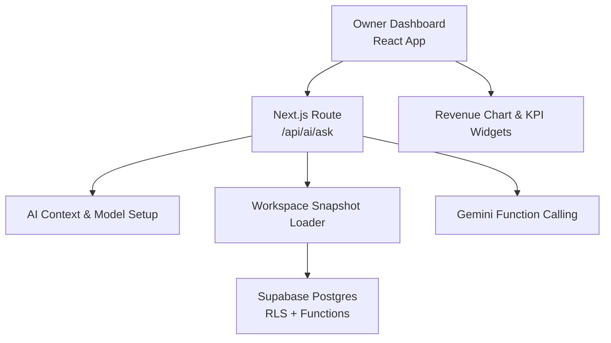
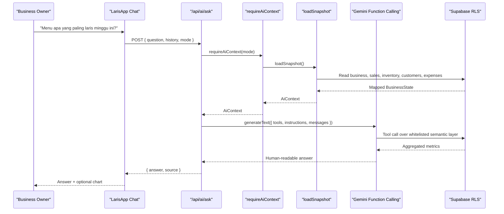
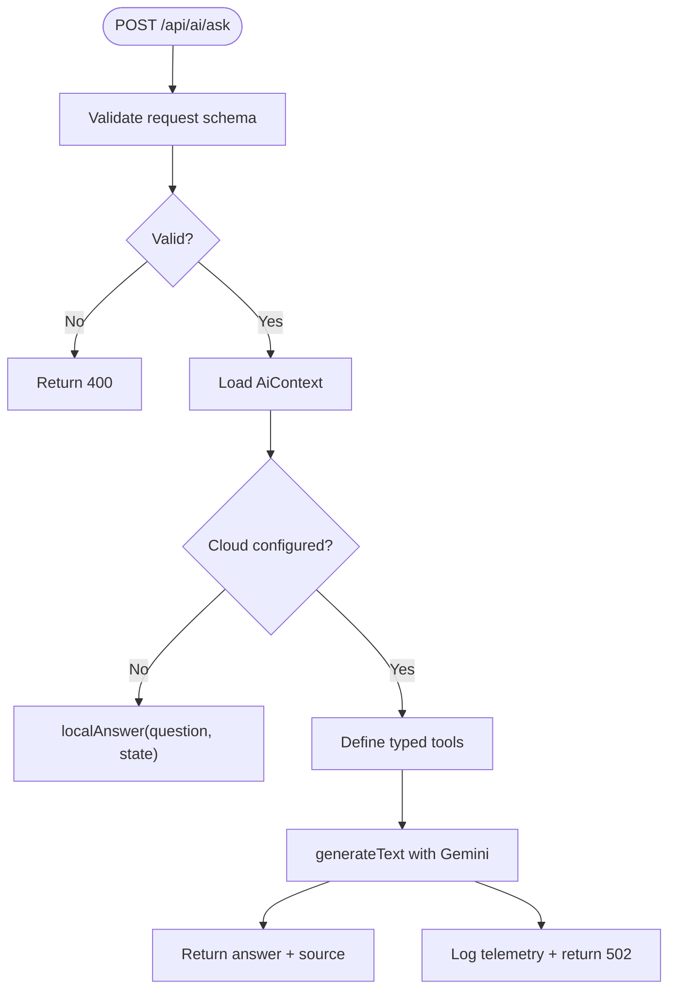
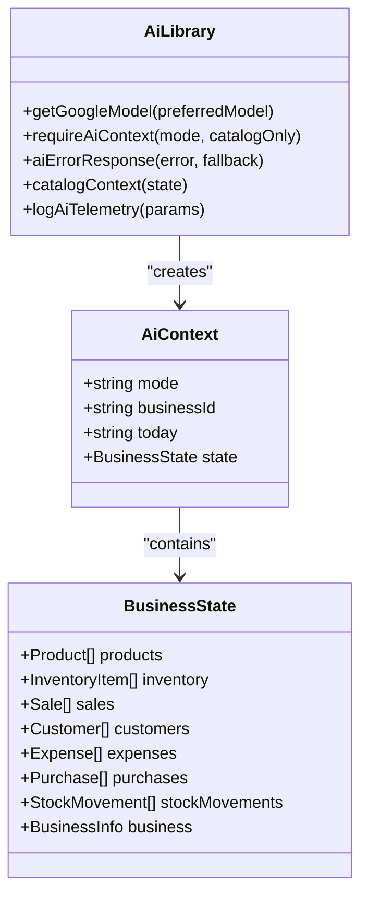
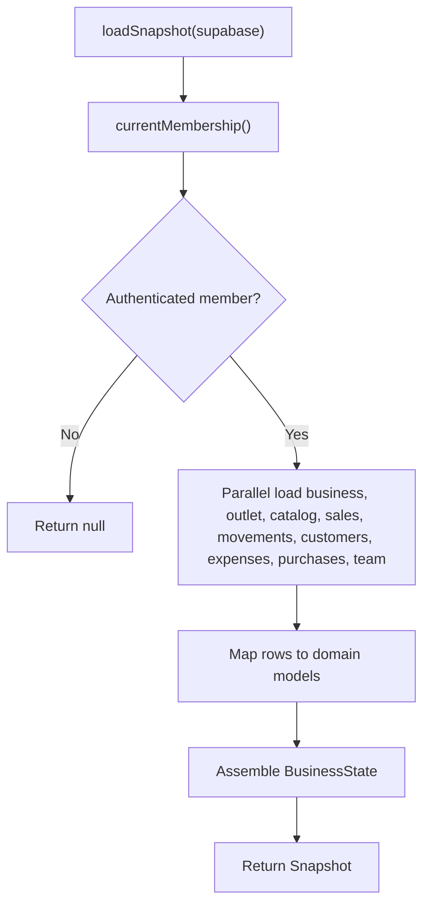
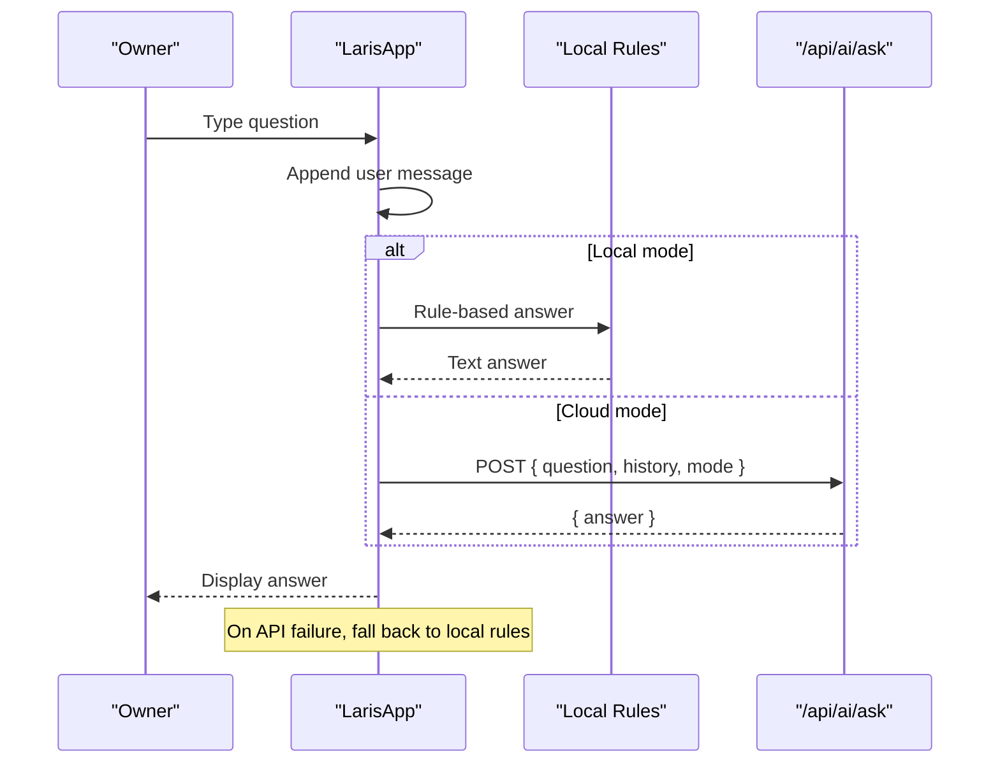
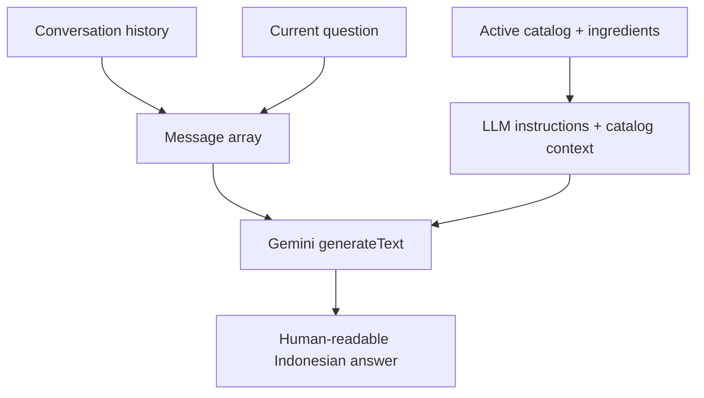
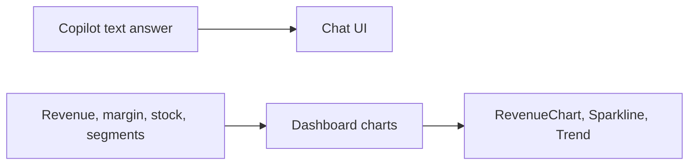
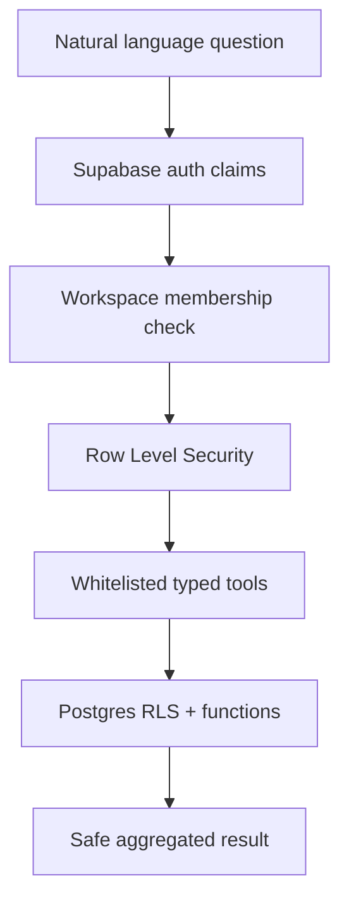

# Tanya Laris Natural Language Copilot

<cite>
**Referenced Files in This Document**   
- [README.md](file://README.md)
- [PRD_Laris_GTNIC2026.md](file://PRD_Laris_GTNIC2026.md)
- [src/app/api/ai/ask/route.ts](file://src/app/api/ai/ask/route.ts)
- [src/lib/ai.ts](file://src/lib/ai.ts)
- [src/lib/laris-data.ts](file://src/lib/laris-data.ts)
- [src/lib/repo.ts](file://src/lib/repo.ts)
- [src/components/laris-app.tsx](file://src/components/laris-app.tsx)
- [src/components/laris-visuals.tsx](file://src/components/laris-visuals.tsx)
- [supabase/migrations/0001_schema.sql](file://supabase/migrations/0001_schema.sql)
- [supabase/migrations/0002_rls.sql](file://supabase/migrations/0002_rls.sql)
- [supabase/migrations/0003_functions.sql](file://supabase/migrations/0003_functions.sql)
- [supabase/migrations/0004_workspaces.sql](file://supabase/migrations/0004_workspaces.sql)
- [supabase/migrations/0005_production_hardening.sql](file://supabase/migrations/0005_production_hardening.sql)
</cite>

## Table of Contents
1. [Introduction](#introduction)
2. [Project Structure](#project-structure)
3. [Core Components](#core-components)
4. [Architecture Overview](#architecture-overview)
5. [Detailed Component Analysis](#detailed-component-analysis)
6. [Supported Question Types and Business Topics](#supported-question-types-and-business-topics)
7. [Context Awareness and Conversation History](#context-awareness-and-conversation-history)
8. [Response Formatting and Data Visualization Integration](#response-formatting-and-data-visualization-integration)
9. [Security and Access Control](#security-and-access-control)
10. [Performance Optimization and Caching Strategy](#performance-optimization-and-caching-strategy)
11. [Troubleshooting Guide](#troubleshooting-guide)
12. [Conclusion](#conclusion)

## Introduction
Tanya Laris is the natural-language business copilot for Laris, an Indonesian UMKM operational system. It lets owners ask questions in Bahasa Indonesia about sales revenue, top products, stock levels, customer segments, expenses, and profit estimates. The system converts a user’s question into structured tool calls over a whitelisted semantic layer, reads workspace data safely under Row Level Security, and returns a human-readable answer in Indonesian.

When cloud AI is unavailable, Tanya Laris falls back to deterministic local rules that still summarize available workspace data without exposing raw SQL or allowing unrestricted database access.

**Section sources**
- [README.md:24-35](file://README.md#L24-L35)
- [PRD_Laris_GTNIC2026.md:227-307](file://PRD_Laris_GTNIC2026.md#L227-L307)

## Project Structure
The Tanya Laris feature spans three layers:

| Layer | Responsibility | Key files |
|---|---|---|
| Frontend UI | Chat input, conversation history, fallback answers, and visual charts | `src/components/laris-app.tsx`, `src/components/laris-visuals.tsx` |
| API route | Request validation, context loading, Gemini function calling, telemetry | `src/app/api/ai/ask/route.ts` |
| Context and data | Workspace snapshot, catalog injection, model setup, error helpers | `src/lib/ai.ts`, `src/lib/repo.ts`, `src/lib/laris-data.ts` |
| Database | Schema, RLS policies, transactional functions, production hardening | `supabase/migrations/*.sql` |

**Diagram sources**
- [src/components/laris-app.tsx:275-310](file://src/components/laris-app.tsx#L275-L310)
- [src/app/api/ai/ask/route.ts:77-217](file://src/app/api/ai/ask/route.ts#L77-L217)
- [src/lib/ai.ts:9-69](file://src/lib/ai.ts#L9-L69)
- [src/lib/repo.ts:129-193](file://src/lib/repo.ts#L129-L193)
- [supabase/migrations/0002_rls.sql:28-41](file://supabase/migrations/0002_rls.sql#L28-L41)

**Section sources**
- [README.md:97-108](file://README.md#L97-L108)
- [PRD_Laris_GTNIC2026.md:319-373](file://PRD_Laris_GTNIC2026.md#L319-L373)

## Core Components
- **Ask API route**: Validates the request, loads workspace context, defines typed tools, calls the LLM with function calling, logs telemetry, and returns either a Gemini-powered answer or a safe fallback.
- **AI library**: Creates the Google Generative AI client, builds `AiContext`, loads catalog-only or full workspace snapshots, injects catalog context into prompts, and handles errors and telemetry.
- **Workspace snapshot loader**: Reads authenticated membership, maps Supabase rows into Laris domain models, and assembles a read-only `BusinessState`.
- **Domain model and demo state**: Defines product, inventory, sale, customer, expense, purchase, and stock movement types; provides deterministic demo data, currency formatting, stock calculation, and order parsing utilities.
- **Frontend chat component**: Sends questions with conversation history, shows pending states, renders assistant responses, and falls back to local rule-based answers when cloud AI fails.
- **Visual components**: Renders revenue charts, sparklines, badges, and empty states used by the dashboard and copilot experience.

**Section sources**
- [src/app/api/ai/ask/route.ts:9-217](file://src/app/api/ai/ask/route.ts#L9-L217)
- [src/lib/ai.ts:9-126](file://src/lib/ai.ts#L9-L126)
- [src/lib/repo.ts:6-202](file://src/lib/repo.ts#L6-L202)
- [src/lib/laris-data.ts:3-110](file://src/lib/laris-data.ts#L3-L110)
- [src/components/laris-app.tsx:275-310](file://src/components/laris-app.tsx#L275-L310)
- [src/components/laris-visuals.tsx:42-75](file://src/components/laris-visuals.tsx#L42-L75)

## Architecture Overview
Tanya Laris uses a guarded, tool-driven architecture rather than letting the LLM write arbitrary SQL.

**Diagram sources**
- [src/components/laris-app.tsx:275-310](file://src/components/laris-app.tsx#L275-L310)
- [src/app/api/ai/ask/route.ts:77-217](file://src/app/api/ai/ask/route.ts#L77-L217)
- [src/lib/ai.ts:30-69](file://src/lib/ai.ts#L30-L69)
- [src/lib/repo.ts:129-193](file://src/lib/repo.ts#L129-L193)

## Detailed Component Analysis

### Ask API Route
The `/api/ai/ask` endpoint is the entry point for Tanya Laris. It validates the request body, loads workspace context, prepares Gemini tools, and generates a response.

Key behaviors:
- Accepts `mode`, `question`, and optional `history`.
- Returns a 400 error for invalid requests.
- Loads cloud context only for authenticated members with a valid workspace.
- Falls back to local rule-based answers when Gemini is not configured.
- Exposes typed tools such as revenue summary, profit summary, top-selling products, low-stock alerts, customer segment summary, and expense breakdown.
- Logs success and failure telemetry.

**Diagram sources**
- [src/app/api/ai/ask/route.ts:9-94](file://src/app/api/ai/ask/route.ts#L9-L94)
- [src/app/api/ai/ask/route.ts:96-217](file://src/app/api/ai/ask/route.ts#L96-L217)

**Section sources**
- [src/app/api/ai/ask/route.ts:9-217](file://src/app/api/ai/ask/route.ts#L9-L217)

### AI Context and Model Setup
The AI library centralizes provider configuration, authentication checks, workspace loading, prompt context injection, and telemetry logging.

Important responsibilities:
- `getGoogleModel`: creates the Gemini client from environment variables.
- `requireAiContext`: returns local demo state for local mode, or authenticated cloud state otherwise.
- `catalogContext`: injects active products, inventory items, and Indonesian ordering terminology into the LLM prompt.
- `logAiTelemetry`: records feature, model, latency, and result status in `ai_event`.

**Diagram sources**
- [src/lib/ai.ts:9-126](file://src/lib/ai.ts#L9-L126)
- [src/lib/laris-data.ts:97-110](file://src/lib/laris-data.ts#L97-L110)

**Section sources**
- [src/lib/ai.ts:9-126](file://src/lib/ai.ts#L9-L126)

### Workspace Snapshot Loader
The repository layer maps Supabase rows into Laris domain models and enforces tenant isolation through authenticated membership.

Highlights:
- `currentMembership` resolves the active business and role.
- `loadCatalog` fetches inventory, products, default variants, and recipe lines.
- `loadSnapshot` aggregates sales, stock movements, customers, expenses, purchases, team info, and audit activity.
- All queries are scoped by `business_id` and protected by RLS.

**Diagram sources**
- [src/lib/repo.ts:114-193](file://src/lib/repo.ts#L114-L193)

**Section sources**
- [src/lib/repo.ts:6-202](file://src/lib/repo.ts#L6-L202)

### Domain Model and Demo State
The domain model defines the shared shape of workspace data used by both local and cloud modes. It also includes deterministic demo data for the Kopi Senja sample business.

Key elements:
- Product, inventory item, sale, customer, expense, purchase, and stock movement interfaces.
- `createInitialState` generates 90 days of realistic F&B transactions.
- `currency` formats IDR values consistently.
- `getStock` calculates current stock from opening stock and ledger movements.
- `parseOrder` supports colloquial Indonesian voice/text orders.

**Section sources**
- [src/lib/laris-data.ts:3-110](file://src/lib/laris-data.ts#L3-L110)
- [src/lib/laris-data.ts:135-141](file://src/lib/laris-data.ts#L135-L141)
- [src/lib/laris-data.ts:172-176](file://src/lib/laris-data.ts#L172-L176)
- [src/lib/laris-data.ts:336-404](file://src/lib/laris-data.ts#L336-L404)
- [src/lib/laris-data.ts:436-474](file://src/lib/laris-data.ts#L436-L474)

### Frontend Chat and Fallback Behavior
The frontend integrates Tanya Laris into the Laris app. In local mode, it uses deterministic rules. In cloud mode, it sends the question and conversation history to `/api/ai/ask`. If the API fails, it falls back to local logic so the copilot remains usable.

**Diagram sources**
- [src/components/laris-app.tsx:275-310](file://src/components/laris-app.tsx#L275-L310)

**Section sources**
- [src/components/laris-app.tsx:275-310](file://src/components/laris-app.tsx#L275-L310)

## Supported Question Types and Business Topics
Tanya Laris supports several core business topics through typed tools and local rules.

| Topic | Example question style | How it works |
|---|---|---|
| Revenue analysis | “Berapa omzet minggu ini?” | Uses `getRevenueSummary` to calculate total revenue, transaction count, average order value, and date range. |
| Profit estimation | “Berapa estimasi laba kotor?” | Uses `getProfitSummary` to subtract recipe-based COGS from revenue and show margin percentage. |
| Top products | “Menu apa yang paling laris?” | Uses `getTopSellingProducts` or local ranking logic. |
| Stock levels | “Bahan apa yang menipis?” | Uses `getLowStockAlerts` to compare current stock against reorder points. |
| Customer insights | “Bagaimana segmen pelanggan saya?” | Uses `getCustomerSegmentsSummary` to count RFM segments. |
| Expenses | “Berapa pengeluaran operasional?” | Uses `getExpensesBreakdown` to aggregate expenses by category. |
| General guidance | Open-ended business questions | Gemini composes a warm, concise Indonesian answer based on tool results and catalog context. |

**Section sources**
- [src/app/api/ai/ask/route.ts:98-174](file://src/app/api/ai/ask/route.ts#L98-L174)
- [src/app/api/ai/ask/route.ts:46-75](file://src/app/api/ai/ask/route.ts#L46-L75)
- [PRD_Laris_GTNIC2026.md:227-307](file://PRD_Laris_GTNIC2026.md#L227-L307)

## Context Awareness and Conversation History
Tanya Laris maintains conversation awareness through two mechanisms:

1. **Conversation history**: The frontend passes previous user and assistant messages to the API. The backend reconstructs the message array and sends it to the LLM so follow-up questions can reference earlier context.
2. **Workspace context**: The LLM receives catalog context including active products, inventory items, prices, costs, and Indonesian ordering terminology. This prevents the model from guessing menu names or fabricating numbers.

**Diagram sources**
- [src/app/api/ai/ask/route.ts:176-192](file://src/app/api/ai/ask/route.ts#L176-L192)
- [src/lib/ai.ts:76-95](file://src/lib/ai.ts#L76-L95)

**Section sources**
- [src/app/api/ai/ask/route.ts:176-192](file://src/app/api/ai/ask/route.ts#L176-L192)
- [src/lib/ai.ts:76-95](file://src/lib/ai.ts#L76-L95)

## Response Formatting and Data Visualization Integration
Responses from Tanya Laris are primarily text, formatted in Indonesian with Rupiah values. The frontend displays these answers directly in the chat interface.

Data visualization integration is layered:
- The dashboard already computes revenue trends, growth, and top products.
- The copilot answer references those metrics in plain language.
- Charts such as `RevenueChart`, `Sparkline`, and KPI widgets are rendered by the visual components.
- Future extensions can attach structured chart payloads to tool results, but the current implementation focuses on readable narrative answers plus existing dashboard visuals.

**Diagram sources**
- [src/components/laris-app.tsx:188-204](file://src/components/laris-app.tsx#L188-L204)
- [src/components/laris-visuals.tsx:42-75](file://src/components/laris-visuals.tsx#L42-L75)

**Section sources**
- [src/components/laris-app.tsx:188-204](file://src/components/laris-app.tsx#L188-L204)
- [src/components/laris-visuals.tsx:42-75](file://src/components/laris-visuals.tsx#L42-L75)

## Security and Access Control
Tanya Laris does not give the LLM direct SQL access. Security is enforced at multiple layers:

| Layer | Protection |
|---|---|
| Authentication | Cloud mode requires Supabase auth claims and a valid membership. |
| Authorization | Workspace snapshot loading checks membership and role. |
| Database access | All ledger writes go through `SECURITY DEFINER` functions; reads use RLS policies. |
| AI guardrails | Gemini function calling is limited to predefined tools with Zod schemas. |
| Input validation | Request body is validated with Zod; question length is bounded. |
| Telemetry safety | Telemetry logging is wrapped in try/catch and never crashes primary requests. |

**Diagram sources**
- [src/lib/ai.ts:30-69](file://src/lib/ai.ts#L30-L69)
- [supabase/migrations/0002_rls.sql:28-41](file://supabase/migrations/0002_rls.sql#L28-L41)
- [supabase/migrations/0003_functions.sql:90-230](file://supabase/migrations/0003_functions.sql#L90-L230)
- [src/app/api/ai/ask/route.ts:77-94](file://src/app/api/ai/ask/route.ts#L77-L94)

**Section sources**
- [src/lib/ai.ts:30-69](file://src/lib/ai.ts#L30-L69)
- [supabase/migrations/0002_rls.sql:28-131](file://supabase/migrations/0002_rls.sql#L28-L131)
- [supabase/migrations/0003_functions.sql:90-320](file://supabase/migrations/0003_functions.sql#L90-L320)
- [supabase/migrations/0005_production_hardening.sql:84-214](file://supabase/migrations/0005_production_hardening.sql#L84-L214)

## Performance Optimization and Caching Strategy
Current performance characteristics:
- The API route is marked dynamic, meaning each request runs server-side without static caching.
- Gemini function calling is limited to four steps via `stopWhen(isStepCount(4))`.
- Local mode avoids external AI latency entirely.
- Cloud mode falls back to local rules when Gemini is unavailable or the API fails.

Recommended optimizations:
- Add short-term in-memory or Redis-style caching for frequent analytical queries such as daily revenue, top products, and low-stock alerts.
- Cache workspace snapshots per business for a short TTL during dashboard refreshes.
- Rate-limit AI endpoints to protect Gemini usage and reduce cost.
- Precompute common aggregations (e.g., daily revenue, top items, RFM counts) using database views or scheduled jobs.
- Use query parameters like `days` and `limit` to keep tool outputs small and predictable.
- Keep conversation history bounded; the current schema allows up to 12 messages.

[No sources needed since this section provides general guidance]

## Troubleshooting Guide
Common issues and resolutions:

| Symptom | Likely cause | Resolution |
|---|---|---|
| Invalid question error | Missing or malformed request body | Ensure the question is between 1 and 2000 characters and history follows the expected structure. |
| Workspace not found | No authenticated membership or missing workspace | Complete onboarding and verify Supabase configuration. |
| Gemini not configured | Missing API key or model environment variable | Configure `GOOGLE_GENERATIVE_AI_API_KEY` and model variables. |
| Copilot returns local answer | Cloud AI failed or is disabled | Check network, API key, and server logs; local rules remain functional. |
| No revenue or profit data | No recorded sales yet | Record transactions first; Tanya Laris explains empty-state behavior. |
| Low-stock alert says no items | Reorder point not set or stock above threshold | Set inventory reorder points and record stock movements. |

**Section sources**
- [src/app/api/ai/ask/route.ts:77-94](file://src/app/api/ai/ask/route.ts#L77-L94)
- [src/app/api/ai/ask/route.ts:193-217](file://src/app/api/ai/ask/route.ts#L193-L217)
- [src/lib/ai.ts:71-74](file://src/lib/ai.ts#L71-L74)
- [src/lib/ai.ts:97-126](file://src/lib/ai.ts#L97-L126)
- [README.md:51-57](file://README.md#L51-L57)

## Conclusion
Tanya Laris is a secure, tool-driven natural-language copilot designed for Indonesian UMKM owners. It translates everyday business questions into structured data queries, respects tenant isolation through RLS, and returns clear Indonesian answers. When cloud AI is unavailable, deterministic local rules keep the system useful. With additional caching, precomputed analytics, and richer chart payloads, Tanya Laris can scale from a helpful demo feature into a robust analytical assistant for real-world operations.

[No sources needed since this section summarizes without analyzing specific files]