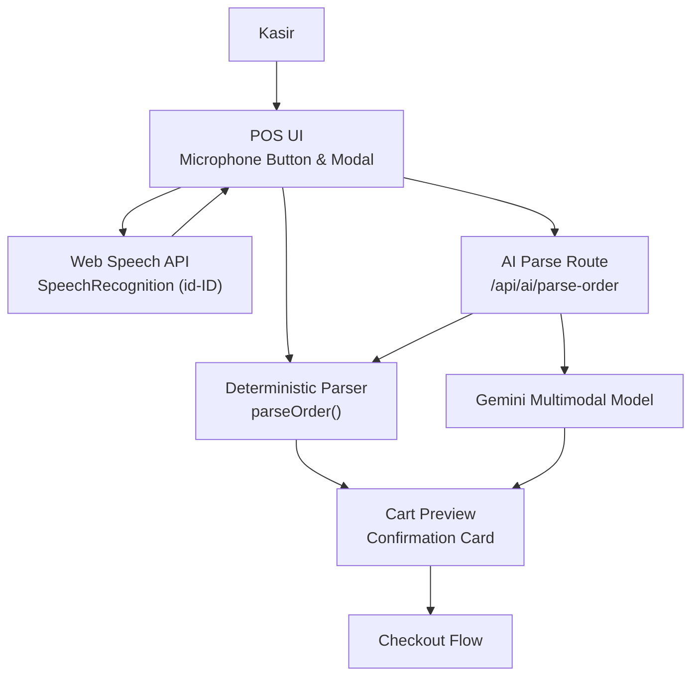
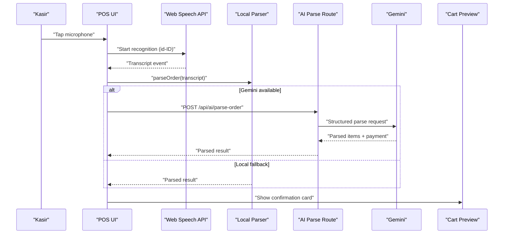
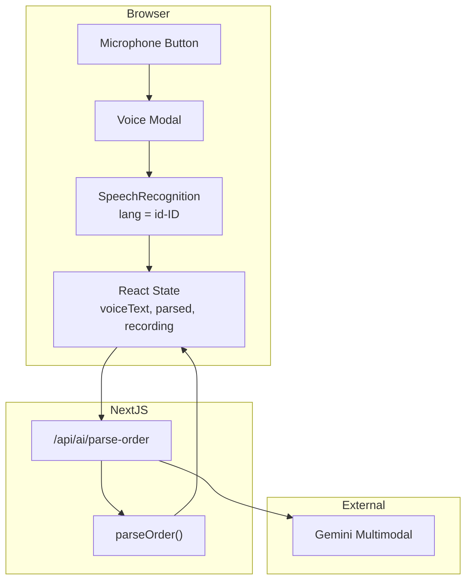
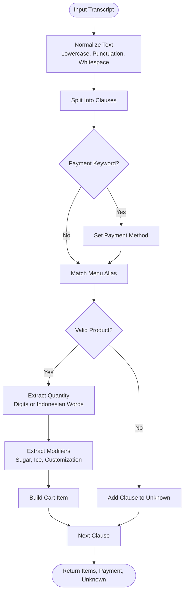
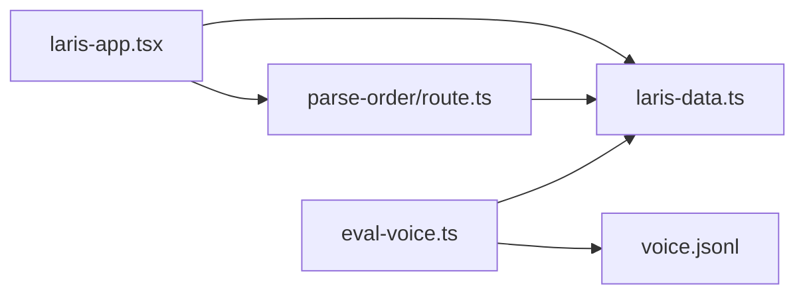

# Voice Recognition System

<cite>
**Referenced Files in This Document**
- [laris-app.tsx](file://src/components/laris-app.tsx)
- [laris-data.ts](file://src/lib/laris-data.ts)
- [route.ts](file://src/app/api/ai/parse-order/route.ts)
- [eval-voice.ts](file://scripts/eval-voice.ts)
- [voice.jsonl](file://evals/voice.jsonl)
- [PRD_Laris_GTNIC2026.md](file://PRD_Laris_GTNIC2026.md)
</cite>

## Table of Contents
1. [Introduction](#introduction)
2. [Project Structure](#project-structure)
3. [Core Components](#core-components)
4. [Architecture Overview](#architecture-overview)
5. [Detailed Component Analysis](#detailed-component-analysis)
6. [Dependency Analysis](#dependency-analysis)
7. [Performance Considerations](#performance-considerations)
8. [Troubleshooting Guide](#troubleshooting-guide)
9. [Conclusion](#conclusion)

## Introduction
This document explains the voice recognition system used by Laris to turn spoken Indonesian orders into structured cart items, payment methods, and unknown phrases. The implementation combines:

- Web Speech API integration for microphone-based speech-to-text with Indonesian language support (`id-ID`).
- A real-time transcription flow that immediately parses the transcript into a cart preview.
- A deterministic order parser backed by the active product catalog.
- An optional AI-powered parsing endpoint that can also accept audio input when configured.
- Fallback mechanisms so the POS remains usable without browser speech support or AI services.
- UI controls for starting and stopping voice capture, visual feedback during recording, and error states for unavailable microphones or unsupported browsers.

The system is designed around human-in-the-loop confirmation: parsed orders are never committed automatically. Unknown items are flagged, and the cashier confirms before checkout.

**Section sources**
- [PRD_Laris_GTNIC2026.md:166-174](file://PRD_Laris_GTNIC2026.md#L166-L174)
- [PRD_Laris_GTNIC2026.md:295-315](file://PRD_Laris_GTNIC2026.md#L295-L315)

## Project Structure
The voice recognition feature spans three main layers:

| Layer | Responsibility | Key Files |
|---|---|---|
| Client UI | Microphone button, modal state, recording indicators, error messages, and manual text fallback | `src/components/laris-app.tsx` |
| Order Parsing | Deterministic Indonesian order parser, catalog aliasing, quantity handling, payment detection, and unknown item reporting | `src/lib/laris-data.ts` |
| AI Endpoint | Optional multimodal parsing via Gemini, request validation, structured JSON output, and local-parser fallback | `src/app/api/ai/parse-order/route.ts` |
| Evaluation | Benchmark suite validating 50 Indonesian utterances against expected cart results | `scripts/eval-voice.ts`, `evals/voice.jsonl` |

**Diagram sources**
- [laris-app.tsx:311-359](file://src/components/laris-app.tsx#L311-L359)
- [laris-data.ts:421-474](file://src/lib/laris-data.ts#L421-L474)
- [route.ts:31-127](file://src/app/api/ai/parse-order/route.ts#L31-L127)

**Section sources**
- [laris-app.tsx:311-359](file://src/components/laris-app.tsx#L311-L359)
- [laris-data.ts:421-474](file://src/lib/laris-data.ts#L421-L474)
- [route.ts:31-127](file://src/app/api/ai/parse-order/route.ts#L31-L127)
- [eval-voice.ts:1-164](file://scripts/eval-voice.ts#L1-L164)
- [voice.jsonl:1-51](file://evals/voice.jsonl#L1-L51)

## Core Components
### Voice Capture and Browser Integration
The POS component implements voice capture through the standard `SpeechRecognition` interface, with a fallback to `webkitSpeechRecognition` for older Chromium-based browsers. When the microphone button is pressed:

1. The application checks whether the browser supports speech recognition.
2. If not supported, it sets an error message directing the user to type the order manually.
3. If supported, it creates a recognition instance, sets the language to Indonesian (`id-ID`), disables interim results, and starts listening.
4. On successful result, the transcript is stored in UI state and passed to the voice parsing handler.
5. On error, recording is stopped and a user-facing error message is shown.
6. On end, recording state is reset.

This design keeps microphone access tightly coupled to the voice modal lifecycle. Closing the modal stops any active recognition instance.

**Section sources**
- [laris-app.tsx:342-359](file://src/components/laris-app.tsx#L342-L359)
- [laris-app.tsx:137-137](file://src/components/laris-app.tsx#L137-L137)

### Real-Time Transcription Handling
When a transcript is received, the component updates two pieces of state:

- `voiceText`: the raw transcript displayed to the cashier.
- `parsed`: the structured order result produced by the parsing pipeline.

The transcription is processed immediately rather than waiting for the user to submit text. This supports the PRD requirement that voice input flows directly into a cart preview.

**Section sources**
- [laris-app.tsx:311-340](file://src/components/laris-app.tsx#L311-L340)
- [laris-app.tsx:109-111](file://src/components/laris-app.tsx#L109-L111)

### Deterministic Order Parser
The core parsing logic lives in `parseOrder`. It converts natural-language Indonesian into:

- `items`: cart items with product ID, quantity, and optional customization notes.
- `payment`: one of `Tunai`, `QRIS`, or `Transfer`.
- `unknown`: phrases that could not be matched to the active catalog.

Key parsing behaviors include:

- Normalizing punctuation such as commas, semicolons, newlines, and conjunctions like `dan`, `&`, and `+`.
- Stripping polite prefixes such as `tolong`, `saya mau pesan`, and similar phrases.
- Detecting payment method keywords at the end of clauses.
- Matching menu names through aliases, slang terms, and normalized product IDs.
- Supporting both numeric digits and Indonesian number words from `satu` to `sepuluh`.
- Capturing modifiers such as `less sugar`, `less ice`, `tanpa gula`, and `sedikit es`.
- Rejecting invalid quantities or unrecognized menu entries by placing them in `unknown`.

The parser is deterministic and does not require network access. It uses the active product catalog to build aliases dynamically, ensuring that inactive products are excluded.

**Section sources**
- [laris-data.ts:406-474](file://src/lib/laris-data.ts#L406-L474)

### AI-Powered Parsing Endpoint
The `/api/ai/parse-order` route extends the voice pipeline with optional multimodal capabilities:

- Accepts either text or base64-encoded audio.
- Validates content length, audio size, MIME types, and request schema.
- Loads workspace context and validates that active menu items exist.
- Uses the Vercel AI SDK and Zod schema to produce structured output.
- Verifies returned product IDs against the active catalog.
- Logs telemetry for latency, model identity, and success/failure.
- Falls back to the deterministic local parser when Gemini is unavailable or fails.

When Gemini is not configured, audio-only requests return a service-unavailable response because audio requires multimodal processing. Text-only requests still work through the local parser.

**Section sources**
- [route.ts:1-127](file://src/app/api/ai/parse-order/route.ts#L1-L127)

### Voice Command Capture Flow
The voice command capture integrates three stages:

1. **Capture**: Web Speech API captures spoken Indonesian.
2. **Parse**: Either the local deterministic parser or the Gemini-backed endpoint parses the transcript.
3. **Confirm**: The resulting cart preview is shown to the cashier before checkout.

**Diagram sources**
- [laris-app.tsx:311-359](file://src/components/laris-app.tsx#L311-L359)
- [route.ts:31-127](file://src/app/api/ai/parse-order/route.ts#L31-L127)
- [laris-data.ts:436-474](file://src/lib/laris-data.ts#L436-L474)

## Architecture Overview
The voice recognition system follows a layered architecture where client-side speech capture is decoupled from parsing logic. This separation allows the same parser to be reused in the browser, server routes, and evaluation scripts.

**Diagram sources**
- [laris-app.tsx:311-359](file://src/components/laris-app.tsx#L311-L359)
- [route.ts:31-127](file://src/app/api/ai/parse-order/route.ts#L31-L127)
- [laris-data.ts:436-474](file://src/lib/laris-data.ts#L436-L474)

## Detailed Component Analysis

### Voice Input UI Components
The voice input UI is part of the main POS application. Its responsibilities include:

- Opening the voice modal from the POS view.
- Rendering a microphone button labeled for voice ordering.
- Showing a loading indicator while parsing is pending.
- Displaying the current transcript in `voiceText`.
- Showing parsed items, payment method, and unknown phrases.
- Allowing the cashier to confirm or correct the parsed order.
- Providing manual text input as a fallback when speech recognition is unavailable.

Error states are surfaced through a shared error state rather than alerts. This keeps errors accessible to screen readers and keyboard navigation.

**Section sources**
- [laris-app.tsx:311-359](file://src/components/laris-app.tsx#L311-L359)
- [laris-app.tsx:96-111](file://src/components/laris-app.tsx#L96-L111)

### Start/Stop Controls and Visual Feedback
The voice control flow uses React state to reflect the current status:

| State | Meaning |
|---|---|
| `recording` | Microphone is actively capturing speech |
| `pendingAi` | Parsing is in progress |
| `voiceText` | Raw transcript from speech recognition |
| `parsed` | Structured order result |
| `error` | Browser, permission, or parsing error |

The microphone button opens the voice modal and resets previous parsing results. Closing the modal stops any active recognition instance and clears recording state.

**Section sources**
- [laris-app.tsx:137-137](file://src/components/laris-app.tsx#L137-L137)
- [laris-app.tsx:311-359](file://src/components/laris-app.tsx#L311-L359)

### Error States and Permission Handling
The implementation handles several failure modes:

| Scenario | Behavior |
|---|---|
| Browser does not support `SpeechRecognition` | Shows error message and directs user to manual text input |
| Microphone permission denied or unavailable | Stops recording and shows error message |
| Speech recognition throws during construction | Catches the exception and shows fallback instruction |
| Network or AI parsing fails | Falls back to deterministic local parser |
| Empty transcript | Parsing is skipped |

Permission-related errors are surfaced as user-friendly messages in Indonesian, consistent with the rest of the POS interface.

**Section sources**
- [laris-app.tsx:342-359](file://src/components/laris-app.tsx#L342-L359)
- [route.ts:31-68](file://src/app/api/ai/parse-order/route.ts#L31-L68)

### Fallback Mechanisms
The system provides multiple fallback paths:

1. **No browser speech support**: Use manual text input instead of microphone capture.
2. **No Gemini configuration**: Audio-only requests fail; text-only requests use the local parser.
3. **Gemini unavailable or failing**: Server returns a fallback response using the deterministic parser.
4. **Client-side AI request failure**: Client falls back to the local parser.
5. **Empty or invalid transcript**: No parsing occurs, preserving existing state.

These fallbacks align with the product principle that AI assists but does not replace manual operations.

**Section sources**
- [laris-app.tsx:311-359](file://src/components/laris-app.tsx#L311-L359)
- [route.ts:64-68](file://src/app/api/ai/parse-order/route.ts#L64-L68)
- [route.ts:113-126](file://src/app/api/ai/parse-order/route.ts#L113-L126)

### Manual Text Input Alternative
Even though the primary focus is voice input, the POS includes manual text entry. The voice modal is opened from the POS view, and if speech recognition is unavailable, users are explicitly told to type the order. The same parsing pipeline processes both voice transcripts and manual text.

**Section sources**
- [laris-app.tsx:342-359](file://src/components/laris-app.tsx#L342-L359)

### Audio Processing and Noise Cancellation
The current implementation delegates audio capture and noise handling entirely to the browser’s Web Speech API. The client does not perform custom audio processing, filtering, or noise cancellation.

Implications:

- Audio quality depends on the browser and device microphone.
- Background noise may reduce transcription accuracy.
- There is no client-side preprocessing such as gain normalization, high-pass filtering, or voice activity detection.
- For production environments with noisy POS counters, consider adding a pre-capture step that warns users about background noise or guides them to a quieter environment.

**Section sources**
- [laris-app.tsx:342-359](file://src/components/laris-app.tsx#L342-L359)

### Performance Optimization for Mobile Devices
The current voice implementation avoids continuous interim results by setting `interimResults = false`. This reduces frequent state updates and parsing calls during long utterances.

Recommended mobile optimizations beyond the current implementation:

- Debounce or coalesce rapid transcript events.
- Avoid re-parsing unchanged transcripts.
- Limit concurrent AI requests.
- Show a clear “Listening…” indicator to prevent repeated taps.
- Handle mobile browser restrictions where speech recognition may pause after a short time.
- Prefer HTTPS, as many browsers restrict microphone access to secure contexts.

**Section sources**
- [laris-app.tsx:342-359](file://src/components/laris-app.tsx#L342-L359)

### Implementation Examples

#### Voice Command Capture
The microphone button triggers `startVoice`, which:

- Checks for `SpeechRecognition` or `webkitSpeechRecognition`.
- Creates a recognition instance.
- Sets language to `id-ID`.
- Starts listening.
- Updates recording state.

**Section sources**
- [laris-app.tsx:342-359](file://src/components/laris-app.tsx#L342-L359)

#### Transcription Handling
On result, the component:

- Extracts the first recognized transcript.
- Stores it in `voiceText`.
- Calls `handleVoiceParse` with the transcript.

**Section sources**
- [laris-app.tsx:349-354](file://src/components/laris-app.tsx#L349-L354)

#### Integration with Order Parsing Pipeline
`handleVoiceParse` decides between:

- Local deterministic parsing in local mode.
- Remote AI parsing in cloud mode.
- Fallback to local parsing when the remote call fails.

The result includes items, payment, and unknown phrases.

**Section sources**
- [laris-app.tsx:311-340](file://src/components/laris-app.tsx#L311-L340)

#### Order Parsing Logic
The deterministic parser normalizes input, splits clauses, detects payment, matches menu aliases, extracts quantities, captures modifiers, and reports unknown phrases.

**Diagram sources**
- [laris-data.ts:436-474](file://src/lib/laris-data.ts#L436-L474)

**Section sources**
- [laris-data.ts:436-474](file://src/lib/laris-data.ts#L436-L474)

### Browser Compatibility Issues
The code explicitly supports both the standard `SpeechRecognition` interface and the prefixed `webkitSpeechRecognition` constructor. However, broader compatibility considerations include:

- Safari historically has limited or inconsistent Web Speech API support.
- Some mobile browsers may block microphone access unless the page is served over HTTPS.
- Permissions must be granted before recognition can start.
- Some browsers may stop recognition unexpectedly due to background tabs or power-saving behavior.

The current fallback strategy ensures that even without speech recognition, the POS remains usable through manual text input.

**Section sources**
- [laris-app.tsx:342-359](file://src/components/laris-app.tsx#L342-L359)

### Permission Management
Microphone permissions are managed by the browser. The application does not request permissions explicitly before calling `start()`. Instead, it relies on the browser’s permission prompt and handles errors in `onerror`.

Recommended improvements:

- Explain why microphone access is needed before prompting.
- Provide a link to browser settings if permission is permanently denied.
- Retry gracefully after permission is granted.
- Surface platform-specific guidance for iOS Safari or Android Chrome.

**Section sources**
- [laris-app.tsx:342-359](file://src/components/laris-app.tsx#L342-L359)

### Accessibility Considerations
The voice interaction should remain accessible even when speech recognition is unavailable:

- Error messages should be visible and readable by assistive technologies.
- Manual text input must remain fully operable.
- Recording state changes should be announced or visually obvious.
- Keyboard navigation should allow opening, interacting with, and closing the voice modal.
- Screen reader users should receive clear feedback when parsing completes or fails.

The modal implementation already uses `role="dialog"` and `aria-modal="true"`, which helps with focus management and accessibility.

**Section sources**
- [laris-app.tsx:54-76](file://src/components/laris-app.tsx#L54-L76)
- [laris-app.tsx:342-359](file://src/components/laris-app.tsx#L342-L359)

## Dependency Analysis
The voice recognition system has clear dependencies across components:

**Diagram sources**
- [laris-app.tsx:311-359](file://src/components/laris-app.tsx#L311-L359)
- [laris-data.ts:436-474](file://src/lib/laris-data.ts#L436-L474)
- [route.ts:31-127](file://src/app/api/ai/parse-order/route.ts#L31-L127)
- [eval-voice.ts:1-164](file://scripts/eval-voice.ts#L1-L164)
- [voice.jsonl:1-51](file://evals/voice.jsonl#L1-L51)

### Coupling and Cohesion
- `laris-app.tsx` owns UI state and orchestration but delegates parsing to `laris-data.ts`.
- `laris-data.ts` is cohesive around domain logic: catalog, stock, sales, purchases, and order parsing.
- `route.ts` is responsible for request validation, AI integration, and telemetry.
- `eval-voice.ts` is independent of runtime UI and only depends on the deterministic parser.

### External Dependencies
- Web Speech API for microphone capture.
- Vercel AI SDK and Gemini for optional multimodal parsing.
- Zod for request and output schema validation.
- Indonesian locale formatting throughout the app, including currency and dates.

**Section sources**
- [laris-app.tsx:311-359](file://src/components/laris-app.tsx#L311-L359)
- [route.ts:1-127](file://src/app/api/ai/parse-order/route.ts#L1-L127)
- [laris-data.ts:135-141](file://src/lib/laris-data.ts#L135-L141)

## Performance Considerations
### Parsing Complexity
The deterministic parser operates per clause in the transcript. For each clause, it:

- Matches against a generated alias pattern.
- Parses quantity tokens.
- Extracts modifier notes.
- Builds a cart item or marks the clause as unknown.

Time complexity is approximately linear in the number of clauses, with additional cost proportional to the number of aliases built from the active catalog. Space complexity grows with the number of parsed items and unknown phrases.

### Memory and State Updates
Avoiding interim results reduces frequent state updates. However, every transcript still triggers a full parse. For long or multi-item orders, this is acceptable for typical POS usage, but debouncing or caching unchanged transcripts could further reduce unnecessary work.

### AI Endpoint Limits
The AI route enforces:

- Maximum body size of 12 MB.
- Maximum audio size of 8 MB.
- Maximum text length of 2000 characters.
- Structured output validation.

These limits protect the server from oversized payloads and malformed requests.

**Section sources**
- [laris-data.ts:436-474](file://src/lib/laris-data.ts#L436-L474)
- [route.ts:7-19](file://src/app/api/ai/parse-order/route.ts#L7-L19)
- [route.ts:31-50](file://src/app/api/ai/parse-order/route.ts#L31-L50)

## Troubleshooting Guide

### Microphone Does Not Start
**Symptoms:**
- Error message says the browser does not support voice input.
- Microphone button does nothing.

**Likely Causes:**
- Browser lacks `SpeechRecognition` or `webkitSpeechRecognition`.
- Page is not served over HTTPS.
- Microphone permission was blocked.

**Resolution:**
- Use a modern browser with Web Speech API support.
- Serve the app over HTTPS.
- Grant microphone permission when prompted.
- Fall back to manual text input.

**Section sources**
- [laris-app.tsx:342-359](file://src/components/laris-app.tsx#L342-L359)

### Transcription Is Empty or Incorrect
**Symptoms:**
- `voiceText` is empty.
- Parsed items do not match spoken order.

**Likely Causes:**
- Background noise.
- Non-Indonesian pronunciation.
- Slang or phrasing outside supported patterns.
- Unsupported browser speech engine.

**Resolution:**
- Speak clearly and slowly.
- Use supported menu names or aliases.
- Try manual text input.
- Verify the evaluation dataset for expected patterns.

**Section sources**
- [laris-data.ts:406-474](file://src/lib/laris-data.ts#L406-L474)
- [voice.jsonl:1-51](file://evals/voice.jsonl#L1-L51)

### AI Parsing Fails
**Symptoms:**
- Cloud mode returns an error or warning.
- Audio-only requests are rejected.

**Likely Causes:**
- Missing Gemini configuration.
- Invalid audio payload.
- Network failure.
- Active catalog missing.

**Resolution:**
- Configure Gemini API key for cloud mode.
- Ensure active menu items exist.
- Use text input when audio is unavailable.
- Check server logs and telemetry.

**Section sources**
- [route.ts:52-68](file://src/app/api/ai/parse-order/route.ts#L52-L68)
- [route.ts:113-126](file://src/app/api/ai/parse-order/route.ts#L113-L126)

### Validation Failures
**Symptoms:**
- Request rejected with validation error.
- Payload too large.

**Likely Causes:**
- Invalid JSON or missing fields.
- Audio exceeds 8 MB.
- Body exceeds 12 MB.

**Resolution:**
- Validate request format.
- Compress or shorten audio.
- Use text input for large payloads.

**Section sources**
- [route.ts:7-19](file://src/app/api/ai/parse-order/route.ts#L7-L19)
- [route.ts:31-50](file://src/app/api/ai/parse-order/route.ts#L31-L50)

## Conclusion
Laris’s voice recognition system provides a practical bridge between spoken Indonesian orders and structured POS data. It prioritizes reliability through deterministic parsing, explicit fallbacks, and human-in-the-loop confirmation. While microphone capture depends on browser capabilities, the application degrades gracefully to manual text input. The optional AI endpoint adds multimodal flexibility, but the core ordering workflow remains functional without external services.

For future improvements, the system would benefit from:

- Explicit microphone permission prompts with clearer guidance.
- Client-side audio preprocessing for noisy environments.
- More robust handling of mobile browser speech interruptions.
- Enhanced accessibility announcements for voice state changes.
- Continued expansion of the evaluation dataset to cover more regional slang and edge cases.