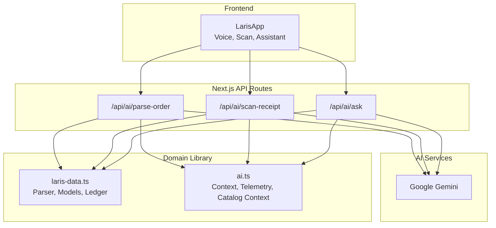
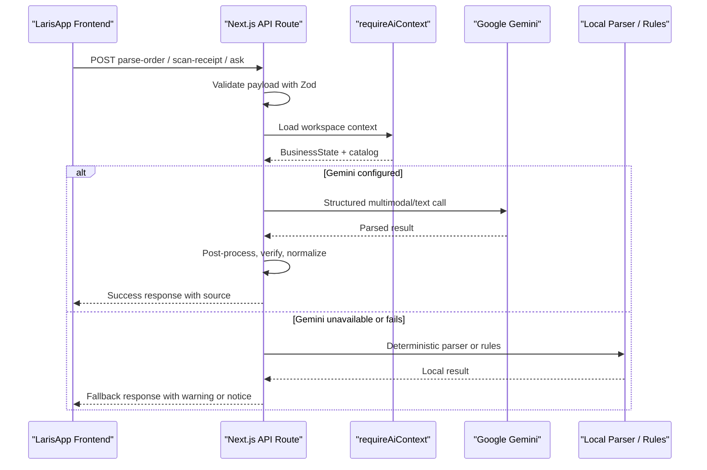
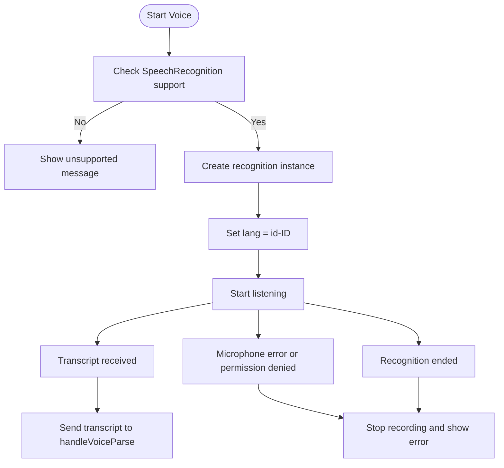
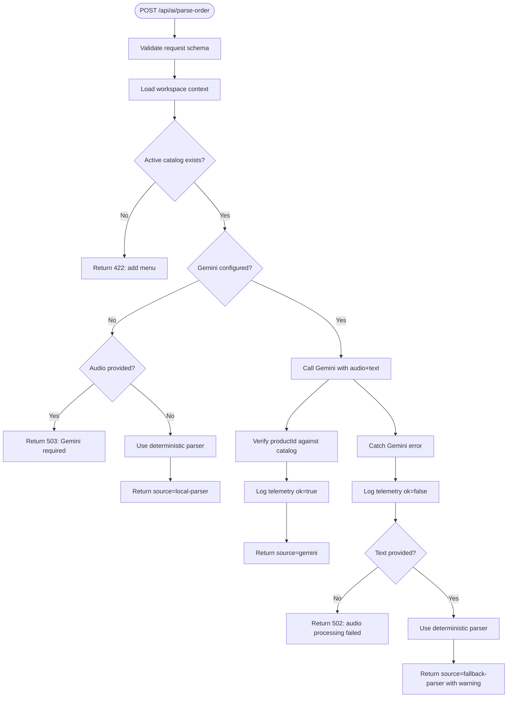
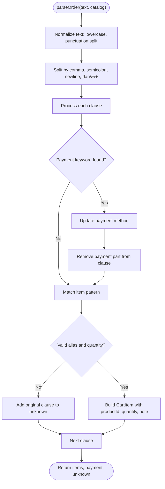
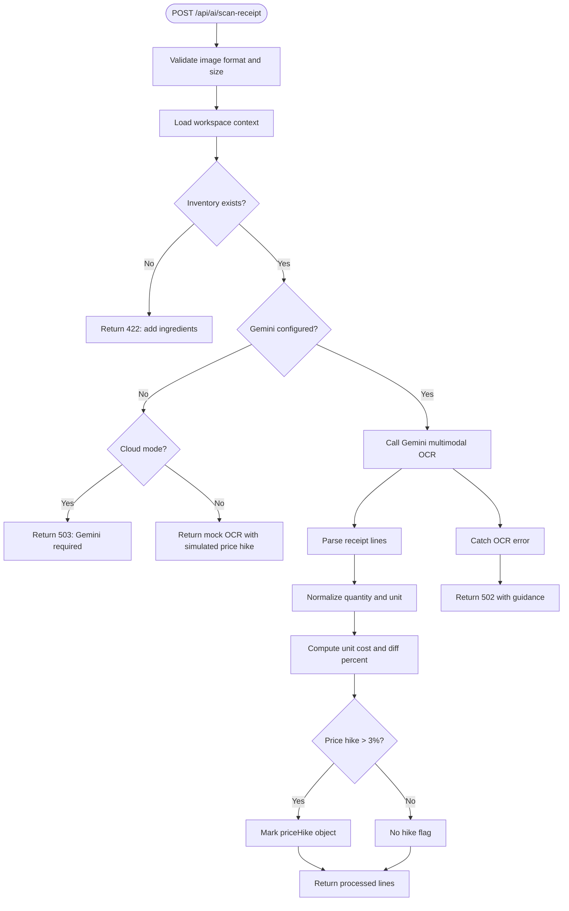
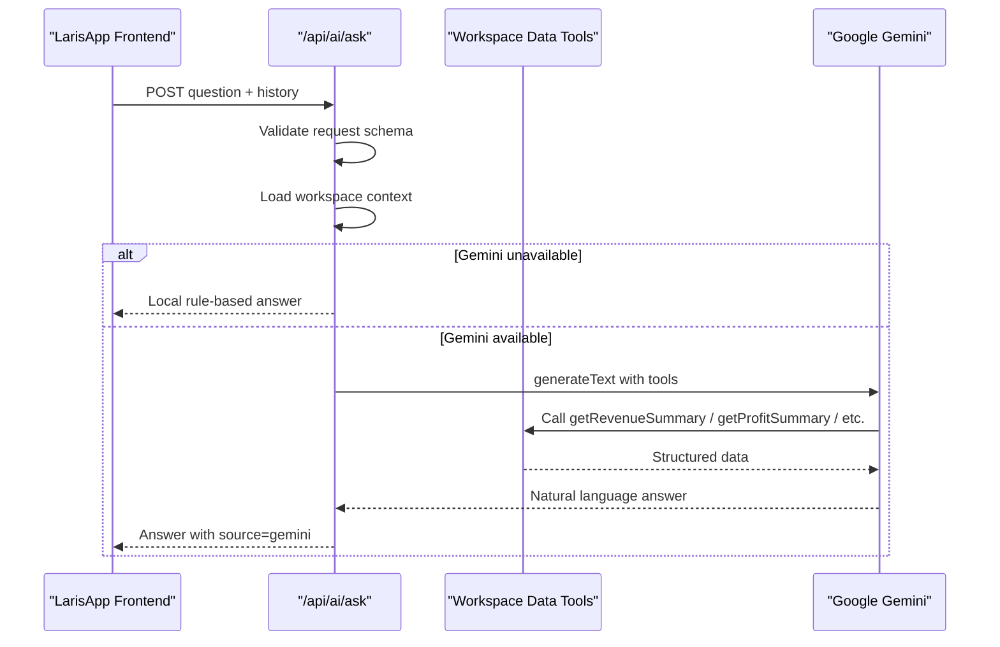
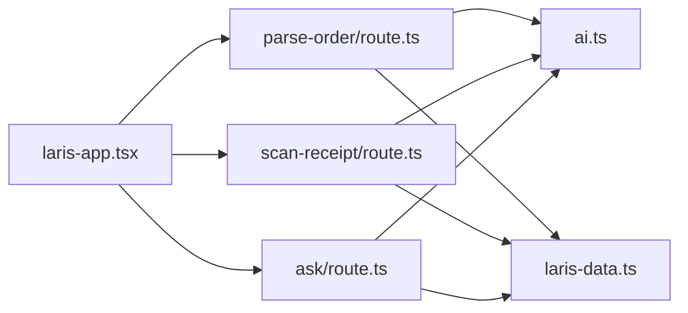

# Voice and AI Features

<cite>
**Referenced Files in This Document**
- [README.md](file://README.md)
- [laris-app.tsx](file://src/components/laris-app.tsx)
- [route.ts (parse-order)](file://src/app/api/ai/parse-order/route.ts)
- [route.ts (scan-receipt)](file://src/app/api/ai/scan-receipt/route.ts)
- [route.ts (ask)](file://src/app/api/ai/ask/route.ts)
- [ai.ts](file://src/lib/ai.ts)
- [laris-data.ts](file://src/lib/laris-data.ts)
- [eval-voice.ts](file://scripts/eval-voice.ts)
- [voice.jsonl](file://evals/voice.jsonl)
</cite>

## Table of Contents
1. [Introduction](#introduction)
2. [Project Structure](#project-structure)
3. [Core Components](#core-components)
4. [Architecture Overview](#architecture-overview)
5. [Detailed Component Analysis](#detailed-component-analysis)
6. [Dependency Analysis](#dependency-analysis)
7. [Performance Considerations](#performance-considerations)
8. [Troubleshooting Guide](#troubleshooting-guide)
9. [Conclusion](#conclusion)

## Introduction
Laris provides AI-powered operational features for Indonesian F&B small businesses. The voice and AI layer supports:
- Voice-to-cart ordering using the Web Speech API with Indonesian language support.
- A deterministic local parser for text orders, with Google Gemini as a fallback for complex or audio-based orders.
- Receipt scanning through multimodal OCR with inventory mapping, unit normalization, and price-hike detection.
- Tanya Laris, a natural-language copilot that answers business questions using workspace data tools.

The system is designed to remain usable when external AI services are unavailable by falling back to deterministic logic, mock data in demo mode, or rule-based summaries.

## Project Structure
The AI features span three layers:
- Frontend UI: voice capture, receipt upload, assistant chat, and confirmation flows.
- Server API routes: request validation, workspace context loading, AI calls, and fallback handling.
- Domain library: deterministic parsing, inventory and sales models, cost calculations, and telemetry helpers.

**Diagram sources**
- [laris-app.tsx:311-390](file://src/components/laris-app.tsx#L311-L390)
- [route.ts (parse-order):31-127](file://src/app/api/ai/parse-order/route.ts#L31-L127)
- [route.ts (scan-receipt):54-214](file://src/app/api/ai/scan-receipt/route.ts#L54-L214)
- [route.ts (ask):77-216](file://src/app/api/ai/ask/route.ts#L77-L216)
- [ai.ts:9-125](file://src/lib/ai.ts#L9-L125)
- [laris-data.ts:421-474](file://src/lib/laris-data.ts#L421-L474)

**Section sources**
- [README.md:24-57](file://README.md#L24-L57)
- [README.md:97-110](file://README.md#L97-L110)

## Core Components
- Voice recognition: Browser-side speech recognition targeting Indonesian (`id-ID`), with graceful error messages when unsupported or permission denied.
- Order parsing pipeline: Local deterministic parser first; Gemini used when configured and available, especially for audio input.
- Receipt scanning: Multimodal OCR via Gemini, followed by inventory matching, unit normalization, and price-hike alerts.
- Tanya Laris copilot: Rule-based local answerer when Gemini is unavailable; otherwise uses structured tools over workspace data.
- Shared infrastructure: Workspace context loading, catalog injection into prompts, Zod schemas, and telemetry logging.

**Section sources**
- [laris-app.tsx:342-359](file://src/components/laris-app.tsx#L342-L359)
- [route.ts (parse-order):14-68](file://src/app/api/ai/parse-order/route.ts#L14-L68)
- [route.ts (scan-receipt):14-107](file://src/app/api/ai/scan-receipt/route.ts#L14-L107)
- [route.ts (ask):46-94](file://src/app/api/ai/ask/route.ts#L46-L94)
- [ai.ts:23-69](file://src/lib/ai.ts#L23-L69)

## Architecture Overview
The AI architecture follows a layered fallback pattern:
1. Frontend validates inputs and captures voice or images.
2. API route validates payloads with Zod and loads workspace context.
3. If Gemini is configured, the route calls Gemini with structured output schemas.
4. On failure or missing configuration, routes fall back to deterministic parsers, mock OCR, or rule-based answers.
5. All successful or failed AI calls log telemetry without crashing user requests.

**Diagram sources**
- [route.ts (parse-order):52-127](file://src/app/api/ai/parse-order/route.ts#L52-L127)
- [route.ts (scan-receipt):98-214](file://src/app/api/ai/scan-receipt/route.ts#L98-L214)
- [route.ts (ask):86-216](file://src/app/api/ai/ask/route.ts#L86-L216)
- [ai.ts:30-69](file://src/lib/ai.ts#L30-L69)

## Detailed Component Analysis

### Voice Recognition System
The frontend implements voice input using the Web Speech API:
- Detects `SpeechRecognition` or `webkitSpeechRecognition`.
- Sets language to Indonesian (`id-ID`).
- Captures transcript and immediately sends it to the order parsing flow.
- Handles browser incompatibility, microphone permission errors, and recording lifecycle.

**Diagram sources**
- [laris-app.tsx:342-359](file://src/components/laris-app.tsx#L342-L359)

**Section sources**
- [laris-app.tsx:342-359](file://src/components/laris-app.tsx#L342-L359)

### AI Order Parsing Pipeline
The order parsing pipeline supports both text and audio:
- Request schema enforces mode, optional text, optional base64 audio, MIME type, and size limits.
- Workspace context is loaded; active product catalog is required.
- If Gemini is not configured:
  - Audio-only requests return a service unavailable error.
  - Text-only requests use the deterministic parser.
- If Gemini is configured:
  - Audio and text are sent as multimodal content.
  - Output is validated against a strict Zod schema.
  - Product IDs are verified against the active catalog; unknown items are moved to an `unknown` array.
  - On Gemini failure, text input falls back to the local parser with a warning.

**Diagram sources**
- [route.ts (parse-order):14-127](file://src/app/api/ai/parse-order/route.ts#L14-L127)

#### Request and Response Schemas
- Request fields:
  - `mode`: `"local"` or `"cloud"`.
  - `text`: optional trimmed string up to 2000 characters.
  - `audio`: optional base64-encoded audio up to 8 MB.
  - `mimeType`: allowed audio MIME types.
- Response fields:
  - `items`: parsed cart items with `productId`, `quantity`, optional `note`.
  - `payment`: `"Tunai"`, `"QRIS"`, or `"Transfer"`.
  - `unknown`: unrecognized phrases or invalid product references.
  - `source`: `"local-parser"`, `"gemini"`, or `"fallback-parser"`.
  - Optional `warning` on fallback.

**Section sources**
- [route.ts (parse-order):14-29](file://src/app/api/ai/parse-order/route.ts#L14-L29)
- [route.ts (parse-order):31-68](file://src/app/api/ai/parse-order/route.ts#L31-L68)
- [route.ts (parse-order):95-127](file://src/app/api/ai/parse-order/route.ts#L95-L127)

### Local Deterministic Parser
The deterministic parser handles realistic Indonesian ordering patterns:
- Supports slang aliases such as `kopsu`, `amer`, `cokelat`, `teh manis`.
- Parses quantities from digits and Indonesian number words.
- Extracts modifiers like less sugar, no sugar, less ice, no ice.
- Detects payment methods and defaults to cash if unspecified.
- Moves unmatched clauses to `unknown` rather than failing the entire request.

**Diagram sources**
- [laris-data.ts:421-474](file://src/lib/laris-data.ts#L421-L474)

**Section sources**
- [laris-data.ts:406-474](file://src/lib/laris-data.ts#L406-L474)

### Receipt Scanning with Multimodal OCR
Receipt scanning supports image uploads via form data or JSON:
- Validates MIME type and size.
- Loads workspace inventory context.
- Without Gemini:
  - Cloud mode returns a service unavailable error.
  - Local demo mode returns mock OCR data with a simulated price increase.
- With Gemini:
  - Sends image and instruction prompt.
  - Normalizes units such as grams to kilograms, milliliters to liters, pieces to dozens.
  - Computes unit cost, compares with current inventory cost, and flags price hikes above 3%.
  - Skips lines with unconvertible units and reports them separately.

**Diagram sources**
- [route.ts (scan-receipt):54-214](file://src/app/api/ai/scan-receipt/route.ts#L54-L214)

#### Receipt Schema and Processing Details
- Receipt schema includes supplier name, date, line items, and total.
- Each line includes raw name, matched inventory code, quantity, unit, unit price, and total price.
- Unit normalization maps common Indonesian and international units to base units.
- Price-hike detection uses percentage difference between new unit cost and existing inventory cost.

**Section sources**
- [route.ts (scan-receipt):14-52](file://src/app/api/ai/scan-receipt/route.ts#L14-L52)
- [route.ts (scan-receipt):109-134](file://src/app/api/ai/scan-receipt/route.ts#L109-L134)
- [route.ts (scan-receipt):157-202](file://src/app/api/ai/scan-receipt/route.ts#L157-L202)

### Tanya Laris Copilot
Tanya Laris answers business questions in Indonesian:
- In local mode, it returns rule-based summaries about revenue, profit, top products, and low stock.
- In cloud mode without Gemini, it still returns a local rule-based answer.
- With Gemini, it exposes typed tools for:
  - Revenue summary over a configurable period.
  - Estimated gross profit based on recipe costs.
  - Top-selling products.
  - Low-stock alerts.
  - Customer segment counts.
  - Expense breakdown.
- The model is constrained to four tool-use steps to limit latency and token usage.

**Diagram sources**
- [route.ts (ask):77-216](file://src/app/api/ai/ask/route.ts#L77-L216)

**Section sources**
- [route.ts (ask):9-16](file://src/app/api/ai/ask/route.ts#L9-L16)
- [route.ts (ask):46-94](file://src/app/api/ai/ask/route.ts#L46-L94)
- [route.ts (ask):96-174](file://src/app/api/ai/ask/route.ts#L96-L174)
- [route.ts (ask):176-216](file://src/app/api/ai/ask/route.ts#L176-L216)

### Confidence Scoring and Result Reliability
The implementation does not expose numeric confidence scores. Instead, reliability is communicated through:
- `source` field indicating whether results came from Gemini, local parser, fallback parser, or mock OCR.
- `unknown` arrays for unrecognized order items.
- `skippedLines` for receipt lines that could not be safely normalized.
- `notice` fields for mock OCR and skipped-line warnings.
- `priceHike` objects for significant cost increases.
- Telemetry logs capturing success/failure, latency, and basic input/output metadata.

For future enhancements, confidence scoring could be added by:
- Returning Gemini model confidence or token usage metrics.
- Computing parser match quality based on alias length, modifier coverage, and clause ambiguity.
- Tracking OCR line-level uncertainty through repeated extraction or multi-image prompts.

**Section sources**
- [route.ts (parse-order):95-127](file://src/app/api/ai/parse-order/route.ts#L95-L127)
- [route.ts (scan-receipt):157-202](file://src/app/api/ai/scan-receipt/route.ts#L157-L202)
- [ai.ts:97-125](file://src/lib/ai.ts#L97-L125)

## Dependency Analysis
The AI features depend on shared infrastructure:
- `ai.ts` provides Gemini initialization, workspace context loading, catalog context injection, error response formatting, and telemetry logging.
- `laris-data.ts` provides domain models, deterministic parsing, ledger operations, and currency formatting.
- Frontend components orchestrate user interactions and call API routes.

**Diagram sources**
- [laris-app.tsx:311-390](file://src/components/laris-app.tsx#L311-L390)
- [route.ts (parse-order):1-127](file://src/app/api/ai/parse-order/route.ts#L1-L127)
- [route.ts (scan-receipt):1-214](file://src/app/api/ai/scan-receipt/route.ts#L1-L214)
- [route.ts (ask):1-216](file://src/app/api/ai/ask/route.ts#L1-L216)
- [ai.ts:1-125](file://src/lib/ai.ts#L1-L125)
- [laris-data.ts:1-494](file://src/lib/laris-data.ts#L1-L494)

**Section sources**
- [ai.ts:9-125](file://src/lib/ai.ts#L9-L125)
- [laris-data.ts:421-474](file://src/lib/laris-data.ts#L421-L474)

## Performance Considerations
- Payload limits prevent large audio and image uploads:
  - Parse order: 12 MB body, 8 MB audio.
  - Scan receipt: 12 MB body, 8 MB image.
- Gemini model selection uses environment variables with a default fast model.
- Tanya Laris limits tool-use steps to reduce latency.
- Telemetry is logged asynchronously and must not crash primary requests.
- Local fallback ensures responsiveness when AI services are slow or unavailable.

Recommendations:
- Add rate limiting per business or IP at the API layer.
- Cache frequent catalog context responses where appropriate.
- Introduce retry budgets and circuit breakers for Gemini calls.
- Surface latency and token usage in telemetry dashboards.
- Consider streaming responses for long-running AI queries.

[No sources needed since this section provides general guidance]

## Troubleshooting Guide
Common issues and their handling:
- Unsupported browser or microphone permission denied:
  - Frontend shows clear Indonesian error messages and falls back to text input.
- Missing Gemini configuration:
  - Parse order returns 503 for audio-only requests; text falls back to local parser.
  - Scan receipt returns 503 in cloud mode; local demo returns mock OCR.
  - Tanya Laris returns local rule-based answers.
- Invalid workspace or authentication:
  - Context loading throws structured errors with 401 or 403 status codes.
- Empty or incomplete catalog/inventory:
  - Parse order returns 422 if no active menu exists.
  - Scan receipt returns 422 if no ingredients exist.
- Gemini failures:
  - Parse order falls back to local parser for text input.
  - Scan receipt returns 502 with guidance to check image clarity.
  - Tanya Laris returns 502 after telemetry logging.

Operational checks:
- Verify `.env` contains `GOOGLE_GENERATIVE_AI_API_KEY` for full AI features.
- Ensure Supabase is configured for cloud mode workspace data.
- Run voice evaluation benchmark to validate deterministic parser accuracy.

**Section sources**
- [laris-app.tsx:342-359](file://src/components/laris-app.tsx#L342-L359)
- [route.ts (parse-order):52-68](file://src/app/api/ai/parse-order/route.ts#L52-L68)
- [route.ts (scan-receipt):98-134](file://src/app/api/ai/scan-receipt/route.ts#L98-L134)
- [route.ts (ask):86-94](file://src/app/api/ai/ask/route.ts#L86-L94)
- [ai.ts:30-74](file://src/lib/ai.ts#L30-L74)
- [README.md:51-57](file://README.md#L51-L57)

## Conclusion
Laris’s voice and AI features combine robust frontend UX, strict server-side validation, deterministic fallbacks, and structured AI integration. The system prioritizes reliability:
- Voice input works locally even without AI services.
- Orders are parsed deterministically and only enhanced by Gemini when safe.
- Receipt scanning normalizes units and highlights price changes.
- Tanya Laris provides actionable business insights grounded in workspace data.
- Telemetry and clear error responses help operators diagnose issues without compromising core operations.

Future improvements should focus on confidence scoring, rate limiting, observability, and controlled retries while preserving the offline-first design philosophy.