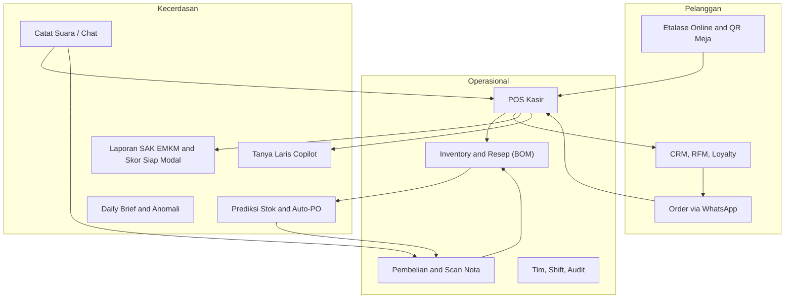
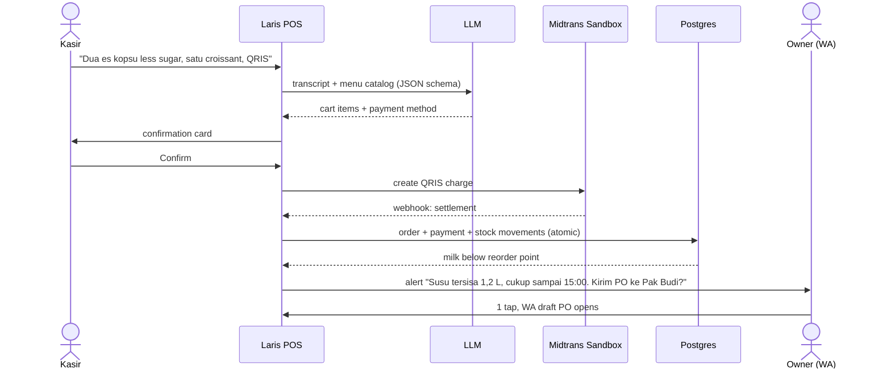
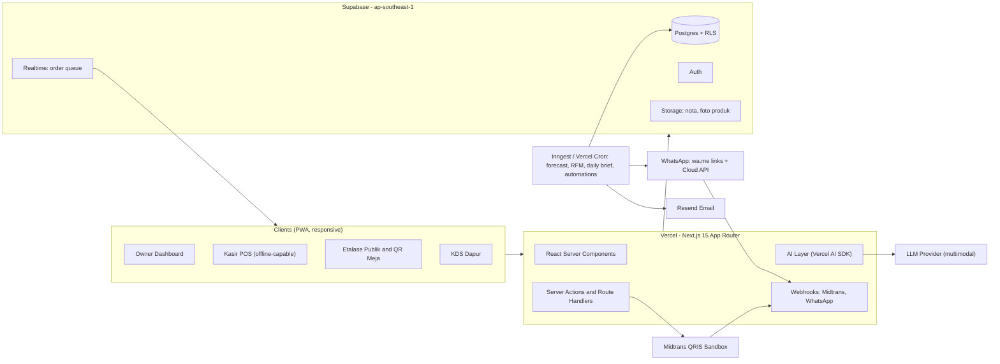
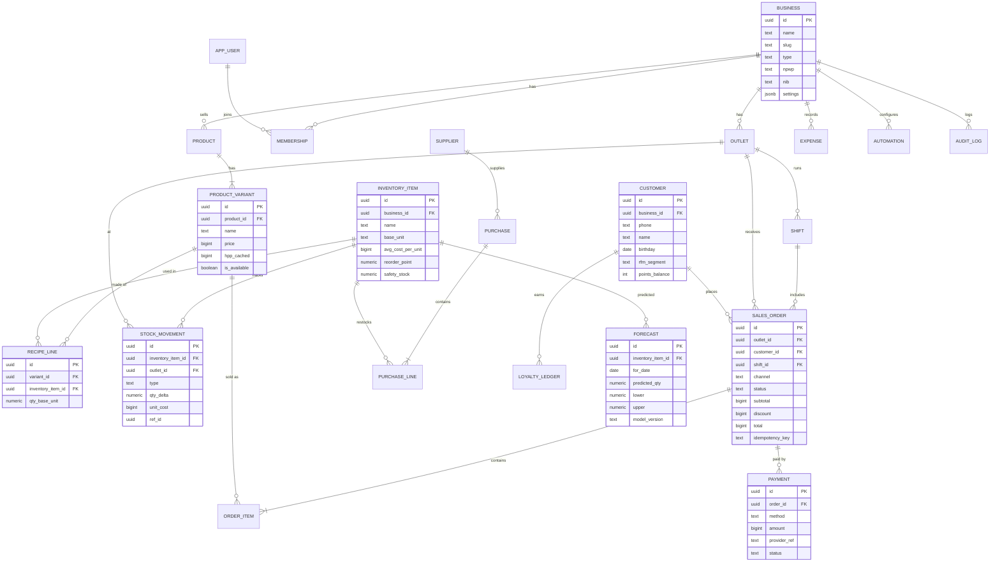

# PRD — **Laris** · AI-Native Business OS for Indonesian UMKM
> *"Catat cukup ngomong. Stok aman. Pelanggan balik lagi."*

| Field | Value |
|---|---|
| Competition | GTNIC 2026 — Web Developer Category |
| Sub-theme | Accelerating Digital Transformation for Business & SMEs |
| Doc version | v1.0 — 18 Oct 2026 |
| Submission deadline | **Tue, 10 Nov 2026, 23:59 WIB** (T-23 days) |
| Internal deadline | **Mon, 9 Nov 2026** (1-day buffer) |
| Working name | **Laris** (from *"laris manis"*, Indonesian for "selling like hotcakes"). Alternatives: *Juragan*, *Kasira*, *Warungku OS* |

> [!WARNING]
> **Timeline check:** You wrote "3 months", but the submission deadline is **23 days away**. Unlimited AI tokens remove the cost of writing code. They don't remove the time it takes to review, integrate, test, and polish the demo.
> This PRD is split into a **Competition Build (23 days)** and a **90-Day Vision** for after submission. The vision also becomes the *Future Development* chapter of the proposal.

---

## 1. Executive Summary

Indonesian UMKM run on **notebooks, WhatsApp chats, and memory**. Most existing tools are form-heavy, need training, and assume stable internet. Many owners still don't know their real profit, run out of stock or waste food, lose customers without noticing, and can't produce the financial reports banks require for loans (KUR).

**Laris** is a mobile-first, offline-capable web app that combines **POS, recipe-level inventory, purchasing, CRM, an online storefront, and financial reports** in one system. An AI layer lets owners **talk to their business**:

- 🎙️ **"Jual dua es kopsu sama satu croissant, bayar QRIS"** → cart filled, QRIS shown, stock deducted.
- 📸 **Photo of a supplier receipt** → purchase recorded, stock and cost of goods (HPP) updated, price-hike alert.
- 🔮 **Stock forecast that knows the Indonesian calendar**: Ramadan, Lebaran, payday (*gajian*), long weekends. One tap sends a draft PO to the supplier on WhatsApp.
- 💬 **"Tanya Laris"**: ask *"Menu apa yang paling untung minggu ini?"* and get an answer plus a chart.
- 🏦 **Skor Siap Modal**: auto-generated SAK EMKM reports and a financing-readiness score with a downloadable KUR document pack.

**Beachhead market:** micro and small F&B businesses (warung, coffee shops, catering, bakeries). This is where recipe tracking, perishable stock, and WhatsApp ordering matter most. Retail comes next.

---

## 2. Problem Statement

> [!IMPORTANT]
> Every statistic in this section must be checked and cited with an official source (Kemenkop UKM, BPS, Bank Indonesia, OJK) before it goes into the proposal. The numbers below are commonly quoted figures, not verified ones.

**Macro context (verify):** about 65 million UMKM, about 60% of GDP, about 97% of the workforce. Digital adoption is growing, but much of it stops at "having a marketplace account". Operations are still manual.

| # | Pain | Who feels it | Consequence |
|---|---|---|---|
| P1 | Manual records (notebooks, phone notes) and personal and business money mixed together | Owner | Real profit unknown, so pricing is wrong |
| P2 | No recipe-level stock or HPP tracking | F&B owner | Stockouts at peak hours, waste, eroding margins |
| P3 | Orders scattered across WhatsApp chats, recapped by hand | Owner, staff | Missed or incorrect orders, slow service |
| P4 | No customer data | Owner | Can't run retention, loyal customers drift away unnoticed |
| P5 | No formal financial statements | Owner | Rejected or never applying for KUR or other financing |
| P6 | Staff leakage (voids, cash differences) | Owner with staff | Silent monthly losses |
| P7 | Existing apps feel complicated, need internet, cost a subscription | Low-tech owners | Abandoned after a week |

**Core insight:** UMKM owners don't lack tools. They lack **time and typing tolerance**. The interface should be **voice, photo, and WhatsApp**, the channels they already use every day.

---

## 3. Goals, Non-Goals, Success Metrics

### 3.1 Goals
1. **G1 — Effortless recording:** record a sale in under 5 seconds, by voice or tap.
2. **G2 — Zero-surprise inventory:** automatic recipe-based stock deduction, forecasts, and reorder suggestions.
3. **G3 — Better customer service:** online storefront, WhatsApp ordering, loyalty, automatic win-back messages.
4. **G4 — Financial clarity and access to capital:** SAK EMKM reports, tax estimate, financing-readiness score.
5. **G5 — Win GTNIC:** meet 100% of the compliance items and deliver a memorable demo.

### 3.2 Non-Goals (competition scope)
- Real money settlement (QRIS runs in **sandbox** only).
- Native mobile apps (a PWA covers this).
- Full HR and payroll (only "lite" attendance and payroll is P2).
- Integrations with marketplaces or GoFood/GrabFood (future work).

### 3.3 Success Metrics
| Metric | Target |
|---|---|
| Time to first sale after signup | < 3 minutes |
| Tap-mode sale recording | < 5 s |
| Voice parse accuracy (50-utterance eval set, colloquial Indonesian) | ≥ 90% exact cart match |
| Receipt OCR line-item accuracy (30 real receipts) | ≥ 85% |
| Forecast MAPE on seeded 90-day data | < 25% |
| Lighthouse (mobile): Performance / A11y / Best Practices / SEO | ≥ 90 / ≥ 95 / ≥ 95 / ≥ 95 |
| Pilot SUS (System Usability Scale) with 3–5 real UMKM | ≥ 75 |
| Console errors or broken links on the judge path | 0 |

---

## 4. Target Users & Personas

| Persona | Profile | Jobs-to-be-done | Key features |
|---|---|---|---|
| **Bu Sari** (48), warung & catering owner | Low tech literacy, WhatsApp power user, Android phone | "I want to know if I'm actually making a profit without writing everything down." | Voice recording, Daily Brief on WA, simple Laba Rugi |
| **Raka** (29), coffee shop owner, 2 outlets | Tech-savvy, growth-minded, 6 staff | "I want to stop running out of milk on Saturdays and know which menu items to push." | Forecast, menu engineering, multi-outlet, anomaly alerts |
| **Dimas** (21), cashier | Fast-paced, shared tablet | "I want to serve the queue fast without mistakes." | PIN login, POS grid, QRIS, offline mode |
| **Mbak Nia** (26), customer | Orders via WA or Instagram | "I want to order and pay without waiting or chatting back and forth." | Storefront, table QR, order tracking, loyalty stamps |

**Market:** micro and small F&B first (high transaction frequency, perishable stock, recipe complexity), then retail and services.

---

## 5. Solution Overview — Three Pillars

---

## 6. Functional Requirements

**Priority legend:** **P0** = must ship for submission · **P1** = should ship (makes the demo stronger) · **P2** = future/stretch

### M0 — Onboarding & Multi-Tenancy
| ID | Requirement | Pri |
|---|---|---|
| M0.1 | Sign up with email or Google. Create a business, choose its type (F&B, retail, service) | P0 |
| M0.2 | **AI Onboarding:** "Ceritakan usahamu" (describe your business) → AI suggests categories, sample products, and units | P1 |
| M0.3 | **Menu photo import:** photograph a menu board or banner → products and prices extracted for review | P1 |
| M0.4 | Multi-tenant isolation through `business_id` and Postgres RLS | P0 |
| M0.5 | Guided product tour (first-run checklist) | P1 |

**Acceptance:** a new user completes onboarding and records the first sale in under 3 minutes. Tenant A can never read Tenant B's rows (verified by an RLS test suite).

### M1 — POS (Kasir)
| ID | Requirement | Pri |
|---|---|---|
| M1.1 | Product grid plus search, categories, variants (size) and modifiers (less sugar, extra shot) | P0 |
| M1.2 | Cart: quantity, notes, item or order discount, tax and service charge toggle | P0 |
| M1.3 | Payments: cash (change calculation, quick-amount buttons), **QRIS via Midtrans sandbox**, transfer, split payment | P0 |
| M1.4 | Digital receipt: WA link (`wa.me` with receipt URL) plus 58/80mm thermal print through browser print CSS | P0 |
| M1.5 | Shift open/close with cash counting and variance report | P1 |
| M1.6 | Order types: dine-in (table), takeaway, delivery. Open bills / save order | P1 |
| M1.7 | **Offline mode:** sales queued in IndexedDB, synced with idempotency keys | P1 |
| M1.8 | Kitchen Display Screen (KDS) with realtime order queue | P1 |
| M1.9 | Cashier PIN login on a shared device. Keyboard shortcuts on desktop | P1 |

**Acceptance:** a completed sale creates `sales_order`, `order_items`, `payment`, and the recipe-driven `stock_movements` **atomically** (in one DB transaction or RPC). A QRIS payment moves to `paid` through the verified webhook.

### M2 — Catat Suara / Chat (Natural-Language Input) ⭐
| ID | Requirement | Pri |
|---|---|---|
| M2.1 | Mic button in the POS → speech-to-text (id-ID) → LLM structured output → cart preview | P0 |
| M2.2 | Understands colloquial terms: *kopsu, es teh manis, goceng (5,000), ceban (10,000), seceng (1,000), "yang biasa"* | P0 |
| M2.3 | The same input works for **expenses** ("beli gas 3 kilo 22 ribu") and **stock-in** | P1 |
| M2.4 | **Human-in-the-loop:** always shows a confirmation card before committing. Unknown items are flagged | P0 |
| M2.5 | Text-chat fallback (works on every browser, including Safari without Web Speech) | P0 |

### M3 — Inventory & Recipes (BOM)
| ID | Requirement | Pri |
|---|---|---|
| M3.1 | Raw materials with base units plus conversions (kg↔g, L↔ml, pack↔pcs) | P0 |
| M3.2 | Recipe (BOM) per variant, e.g. Es Kopi Susu = 18 g coffee + 150 ml milk + 20 ml palm sugar + 1 cup | P0 |
| M3.3 | Automatic deduction on sale. Ledger-based `stock_movements` (never overwrite quantities) | P0 |
| M3.4 | Stock opname (physical count) → variance report | P1 |
| M3.5 | Waste log with reasons (expired, spilled, failed batch) | P1 |
| M3.6 | Low-stock alerts (threshold or forecast-based) | P0 |
| M3.7 | Batch/expiry tracking with FEFO hints | P2 |
| M3.8 | Recipe-level **HPP** (cost of goods) and **margin per menu item**, recalculated automatically when purchase prices change | P0 |

### M4 — Purchasing & Scan Nota ⭐
| ID | Requirement | Pri |
|---|---|---|
| M4.1 | Supplier directory (name, WA number, lead time, items supplied) | P0 |
| M4.2 | Purchase entry → stock-in movement → moving-average cost update | P0 |
| M4.3 | **Scan Nota:** upload or photograph a receipt (including handwritten) → multimodal LLM extracts items, quantities, prices → fuzzy-matched to inventory → user confirms | P0 |
| M4.4 | **Price-hike alert:** "Harga susu naik 12% → margin Es Kopi Susu turun dari 62% ke 55%. Naikkan harga Rp1.000?" | P1 |
| M4.5 | Purchase orders: draft → sent (WA deep link with formatted message) → received | P1 |

### M5 — Prediksi Stok & Auto-Reorder ⭐
| ID | Requirement | Pri |
|---|---|---|
| M5.1 | Nightly 14-day demand forecast per menu item, broken down into raw-material demand through the BOM | P0 |
| M5.2 | **Indonesian calendar features:** weekday seasonality, national holidays, Ramadan (shifted hours, iftar peak), Lebaran, payday window (25th–1st), school holidays | P0 |
| M5.3 | Reorder point = demand during lead time + safety stock (service level z = 1.65) | P0 |
| M5.4 | "Belanja Besok" list → **one tap sends a draft PO to the supplier via WhatsApp** | P0 |
| M5.5 | Explainability: *"Prediksi naik 40% karena Sabtu + tanggal gajian"* plus forecast accuracy shown (MAPE) | P1 |
| M5.6 | Cold start: category priors plus the owner's "rata-rata jual per hari" (average daily sales) input | P1 |

### M6 — CRM & Loyalty
| ID | Requirement | Pri |
|---|---|---|
| M6.1 | Customer created automatically from a phone number at checkout or a storefront order | P0 |
| M6.2 | Profile: visits, total spend, favorite items, last visit | P0 |
| M6.3 | **RFM segmentation**: *Juara, Setia, Potensial, Berisiko, Hilang* (Champions, Loyal, Potential, At Risk, Lost) | P0 |
| M6.4 | Loyalty: points or digital stamps ("beli 9 gratis 1"), redeemable at the POS | P1 |
| M6.5 | **Automations:** win-back (no visit in 21 days), birthday promo, thank-you plus 1-tap rating after purchase | P1 |
| M6.6 | Broadcast to a segment (WA deep link batch in P0, WA Cloud API in P1) with AI-written copy | P1 |
| M6.7 | Feedback inbox: low ratings trigger an owner alert | P2 |

### M7 — Etalase Online & Order via WA
| ID | Requirement | Pri |
|---|---|---|
| M7.1 | Auto-generated public storefront `laris.app/{slug}` (SEO, OG image, mobile-first) | P0 |
| M7.2 | Table QR (dine-in) → customer orders and pays from their phone | P1 |
| M7.3 | Orders appear **in realtime** in the POS/KDS queue, with a sound cue | P0 |
| M7.4 | Customer order-tracking page (Diterima → Diproses → Siap → Selesai) | P1 |
| M7.5 | **WA Order Bot** (WA Cloud API test number): chat to order, with an AI agent confirming items and sending a payment link | P1 |
| M7.6 | Operating hours, out-of-stock items auto-hidden (based on stock) | P0 |

### M8 — Dashboard & "Tanya Laris" Copilot ⭐
| ID | Requirement | Pri |
|---|---|---|
| M8.1 | KPI cards: revenue, transactions, average ticket, gross margin, vs. previous period | P0 |
| M8.2 | Charts: revenue trend, **peak-hour heatmap**, top items, payment mix | P0 |
| M8.3 | **Menu engineering matrix**: Stars, Plowhorses, Puzzles, Dogs (popularity × margin), with action tips | P1 |
| M8.4 | **Tanya Laris:** natural-language questions → tool calls over a **whitelisted semantic layer** (no raw SQL from the LLM) → answer plus auto-chart | P0 |
| M8.5 | **Daily Brief** at a configurable time (WA/email/in-app): revenue, top item, stock risks, one recommendation | P1 |
| M8.6 | **Anomaly alerts:** spikes in voids or refunds per cashier, cash variance, unusual discounts (z-score) | P1 |

### M9 — Keuangan (Finance)
| ID | Requirement | Pri |
|---|---|---|
| M9.1 | Expense records with categories, recurring expenses, receipt photos | P0 |
| M9.2 | Profit & Loss (Laba Rugi), cash flow (Arus Kas), simple balance sheet (Neraca), per **SAK EMKM** | P0 |
| M9.3 | **Tax estimate:** PPh Final UMKM (0.5% of gross revenue per PP 55/2022, including the Rp500 million exemption for individual taxpayers; *verify the current rules*) | P1 |
| M9.4 | **Skor Siap Modal** (0–100): months of data, revenue consistency, margin, growth trend, separation of expenses, document completeness (NIB/NPWP), each with improvement tips | P1 |
| M9.5 | **KUR document pack:** one-click PDF (business profile, last 6 months of P&L, cash flow, sales trend) | P1 |
| M9.6 | Export PDF and Excel | P0 |

> [!CAUTION]
> Label Skor Siap Modal as a self-assessment tool, **not** a licensed credit score. Put a disclaimer in both the UI and the proposal.

### M10 — Team, Access & Audit
| ID | Requirement | Pri |
|---|---|---|
| M10.1 | Roles: Owner, Manager, Kasir, Dapur, with a permission matrix | P0 |
| M10.2 | Invite staff by link. Cashier PIN | P1 |
| M10.3 | Audit log for sensitive actions (void, refund, price change, stock adjustment) | P0 |
| M10.4 | HR-lite: clock-in/out, simple payroll calculation (daily rate × attendance + bonus) | P2 |

### M11 — Multi-Outlet *(P1)*
Outlet switcher, per-outlet stock, stock transfers between outlets, consolidated dashboard.

### M12 — Platform
PWA install, offline POS, notification center, dark mode, **ID/EN language switch**, responsive layout from 360 px to 1440 px+.

---

## 7. The "Golden Demo Path" (the 90-second wow moment)

This flow is what the judges will remember. **Build it first, polish it most, and test it every day.**

Then switch to the owner's phone: **Dashboard → "Tanya Laris: kenapa omzet Sabtu kemarin turun?" → answer with chart → Skor Siap Modal → download KUR PDF.**

---

## 8. AI & Smart-Feature Design

| Feature | Approach | Guardrails |
|---|---|---|
| Voice/Chat → Cart | Web Speech API (id-ID) for live transcripts, with a fallback that sends audio to a multimodal LLM. LLM with **structured output (JSON schema)**, given the business's catalog plus a slang glossary | Confirmation card, confidence score per line, unknown items never auto-created |
| Scan Nota | Multimodal LLM (image → items JSON) → fuzzy match (trigram, `pg_trgm`) to inventory items | User confirms matches. Original image stored |
| Forecast | **Deterministic stats, not an LLM:** Holt-Winters / exponential smoothing with weekly seasonality plus holiday multipliers learned from history (priors for cold start) | Show MAPE. LLM only writes the explanation sentence |
| Tanya Laris | LLM **function calling** over around 15 typed tools (`getRevenue(range, groupBy)`, `getTopItems`, `getStockRisk`, `compareperiods`…), each running parameterized queries under the user's RLS context | No raw SQL, read-only, statement timeout, rate limit, prompt-injection filter |
| RFM | Quintile scoring on recency, frequency, monetary value. Nightly job | Deterministic |
| Anomaly | Rolling z-score per cashier and shift on voids, discounts, cash variance | Alert only, never auto-punish |
| Copywriting | LLM writes promo and broadcast text in the business's tone | Owner edits before sending |

**Model strategy:** model-agnostic through the **Vercel AI SDK**. Default to a fast, cheap multimodal model (e.g. Gemini Flash-class) for parsing and OCR, and a stronger model for the Copilot. All prompts are versioned in the repo.

**AI evaluation harness (unlimited tokens pays off here):**
- `evals/voice.jsonl`: 50+ utterances (slang, typos, mixed Javanese/Sundanese words) → expected carts.
- `evals/receipts/`: 30+ receipt photos → expected line items.
- `evals/copilot.jsonl`: 40 questions → expected tool calls.
- Runs in CI and fails the build if accuracy drops below threshold. **Put the results table in the proposal.**

**Graceful degradation:** if the AI provider is down, every feature still works through manual UI. AI is an accelerator, not a dependency.

---

## 9. System Architecture

### 9.1 Tech Stack
| Layer | Choice | Why |
|---|---|---|
| Framework | **Next.js 15 (App Router) + TypeScript** | SSR/SEO for the storefront, server actions, one deploy |
| UI | **Tailwind CSS v4 + shadcn/ui + Framer Motion**, Recharts | Fast and consistent. Allowed by the competition rules |
| Font | **Plus Jakarta Sans** (designed in Indonesia) + tabular numerals | Local identity, readable numbers |
| DB/Auth/Storage/Realtime | **Supabase (Postgres)** + Drizzle ORM | RLS multi-tenancy, realtime queue, free tier |
| Offline | Serwist (service worker) + Dexie (IndexedDB) outbox | POS keeps working without internet |
| AI | Vercel AI SDK + multimodal LLM | Structured outputs, provider-agnostic |
| Payments | **Midtrans** Core API QRIS (sandbox) | De-facto standard in Indonesia |
| Messaging | `wa.me` deep links (P0) + WhatsApp Cloud API test number (P1) | Zero-cost fallback, real bot for the demo |
| Jobs | Inngest (or Supabase pg_cron + Edge Functions) | Nightly forecasts, automations |
| PDF | `@react-pdf/renderer` | Reports and KUR pack |
| Quality | Vitest, **Playwright (Chromium, Firefox, WebKit)**, axe-core, ESLint, GitHub Actions | Covers the cross-browser requirement |
| Observability | Sentry, Vercel Analytics, PostHog | Errors and usage proof |
| Hosting | **Vercel** + Supabase Singapore region | Public live URL, low latency to Indonesia |

---

## 10. Database Schema

**Conventions:**
- Every tenant table has `business_id` plus an RLS policy.
- IDs are **UUIDv7**, generated on the client so offline sales can sync.
- Money is stored as `BIGINT` rupiah (no floats). Quantities are `NUMERIC(14,3)` in base units.
- Stock is a **ledger** (`stock_movements`). The current stock level is a materialized view.
- Soft delete (`deleted_at`) and `created_at`/`updated_at` on every table.

Supporting tables not shown: `category`, `modifier_group`, `modifier`, `unit_conversion`, `supplier`, `table_qr`, `automation_run`, `notification`, `ai_event` (prompt/response logging for evals), `holiday_calendar`.

---

## 11. Non-Functional Requirements

| Area | Requirement |
|---|---|
| **Responsive** | Breakpoints at 360 / 768 / 1024 / 1440. POS usable **one-handed on a phone**, split view on tablets, keyboard-driven on desktop |
| **Browsers** | Chrome, Firefox, Safari (iOS and macOS), Edge. Playwright matrix in CI plus manual testing on a real iPhone |
| **Performance** | LCP < 2.5 s on 4G. POS add-to-cart < 100 ms (optimistic UI). JS budget < 200 KB per route for the storefront |
| **Accessibility** | WCAG 2.2 AA: contrast, focus rings, ARIA labels, 44 px tap targets, `prefers-reduced-motion` |
| **Security** | RLS on all tables. Zod validation on every server action. Midtrans/WA webhook signature checks. Rate limiting (Upstash). CSP headers. OWASP Top-10 review |
| **Privacy** | Compliant with **UU PDP No. 27/2022**: consent for marketing messages, data export and delete for customers, minimal PII |
| **Reliability** | Offline outbox with idempotency. Daily DB backups. Feature flags for AI features |
| **SEO** | Storefront has a unique title and meta per business, OG images, JSON-LD (`LocalBusiness`, `Menu`), sitemap |
| **i18n** | Bahasa Indonesia by default, English toggle (helps judges) |

---

## 12. UX & Design System

**Principles**
1. **"Bahasa warung"**: plain words, no accounting jargon in the main UI ("Untung bersih", not "Net income").
2. **Thumb-first**: primary actions at the bottom of the screen on mobile.
3. **AI suggests, the human decides**: every AI action shows a preview and needs confirmation.
4. **Show money confidently**: large tabular numerals, Rp formatting (`Rp12.500`).

**Visual identity**
- Palette: deep ink `#0B1220`, **Laris Saffron** `#F5A524` (primary, for warmth and prosperity), **Pandan Green** `#1F9D74` (success/profit), **Cabai Red** `#E5484D` (alerts), warm off-white `#FBF8F3`.
- Light and dark modes. Subtle *batik kawung* geometric pattern on empty states and the cover.
- Micro-interactions: cart item "pop", QRIS success check animation plus an optional "ka-ching", skeleton loaders, number count-up on KPIs.

**Key screens (also the proposal screenshot list):**
Landing page · Onboarding · POS (mobile, tablet) · Voice confirmation card · QRIS payment · Receipt · Inventory and recipe editor · Scan Nota review · Forecast and "Belanja Besok" · CRM segments · Storefront (customer view) · KDS · Dashboard · Tanya Laris · Financial reports · Skor Siap Modal.

---

## 13. Judge Experience (often overlooked, high impact)

- **"Masuk sebagai Juri / Try Demo"** button on the landing page: one-click login to a seeded business. No signup needed.
- **Seeded business "Kopi Senja"**: 2 outlets, about 40 menu items, about 60 raw materials, 90 days and about 9,000 realistic transactions (with weekly, payday, and holiday patterns), about 800 customers, 6 staff, a few planted anomalies. **Generated by a deterministic seed script.**
- Demo data **resets nightly** (cron) so the judges always see a clean state.
- A floating **"Demo Guide"** walks through the golden path in 7 steps.
- The README contains the live URL, demo credentials, architecture, setup steps, and an env example.

---

## 14. Competition Compliance Matrix

| Requirement | How Laris satisfies it | Evidence |
|---|---|---|
| Fits the sub-theme and UMKM focus | POS, inventory, CRM, dashboard for UMKM | Proposal chapters 1–3 |
| Interactive, not static | Full CRUD, transactions, realtime | Live demo |
| Form and data processing | Product, recipe, purchase, expense, and order forms with validation | Screenshots |
| Database interaction | Postgres with 25+ tables, RLS | ERD in the proposal |
| Smart features and automation | Voice POS, Scan Nota, forecast, Copilot, RFM automations, Daily Brief | Eval results |
| Responsive | 360–1440 px, PWA | Device screenshots |
| Cross-browser | Playwright matrix (Chromium, Firefox, WebKit) + Edge | CI badge |
| Live hosting | Vercel public URL | Link |
| Public repository | GitHub public, MIT license, clean commit history | Link |
| Original work | Built from scratch, no cloned templates | Commit history, statement letter |
| Proposal format | A4, TNR 12, 1.5 spacing, margins L4/T3/R3/B3 cm, ≤ 15 pages, **GTNIC 2026 logo on cover** | PDF |
| File name | `GTNIC2026_WebDev_NamaTim.pdf` | — |
| Video | 3–5 min, public YouTube/Drive, team intro and pitch | Link |
| Surat Pernyataan Keaslian Karya | Signed, scanned | PDF |

> [!IMPORTANT]
> **Originality:** write the code yourselves (AI-assisted is fine) and commit in small, frequent steps from day one. Judges may read the Git history. Don't fork a boilerplate or dashboard template wholesale. Use only permissively licensed libraries, and make all seed data and images fictional or generated.

---

## 15. Build Plan — 23 Days

| Phase | Dates | Deliverables |
|---|---|---|
| **0. Foundation** | Sun 18 – Tue 20 Oct | PRD locked. Design system and high-fidelity mockups. Repo, CI, **Vercel + Supabase deployed on day 1**. Schema v1 + RLS tests. Seed script skeleton |
| **1. Core Ops** | Wed 21 – Tue 27 Oct | Auth and onboarding, products/variants/modifiers, recipes, POS, cash + **QRIS sandbox**, atomic stock deduction, purchases, customers, receipts, roles, audit log |
| **2. Intelligence & Customer** | Wed 28 Oct – Tue 3 Nov | Voice/chat input, Scan Nota, forecast + Belanja Besok + WA PO, dashboard + heatmap, Tanya Laris, RFM + loyalty, storefront + realtime queue + KDS, financial reports, Skor Siap Modal, Daily Brief |
| **Field pilot** (parallel) | Sat 31 Oct – Sun 1 Nov | Test with 3–5 real UMKM near you: SUS questionnaire, quotes, photos (with consent). **Huge credibility boost for the proposal** |
| **3. Hardening** | Wed 4 – Fri 6 Nov | Offline PWA, responsive QA, cross-browser testing, a11y, Lighthouse, full 90-day seed, judge demo mode. **Feature freeze Fri 6 Nov, 23:59** |
| **4. Content** | Sat 7 – Sun 8 Nov | Screenshots, video recording and editing, proposal finalized (drafting starts 28 Oct), originality statement |
| **5. Submit** | **Mon 9 Nov** | Submit the Google Form with all links. Verify every link from an incognito window |
| Buffer | Tue 10 Nov | Emergencies only |

**Daily rituals:** run the golden path end-to-end on production every evening. Run eval scores in CI.

### 15.1 Using "Unlimited AI Tokens" Wisely
- **Parallel agent workstreams** with clear module boundaries (POS, Inventory, AI, Storefront, Reports), each with its own tests.
- Use AI for the high-volume, low-taste work: seed data, test suites, eval datasets, i18n strings, ERD docs, proposal first drafts, image assets.
- **AI code review on every PR** plus a human "taste gate" on UX and the demo path.
- The bottleneck is **integration and polish, not code volume.** Resist scope creep after 3 Nov.

---

## 16. Proposal Blueprint (≤ 15 pages)

| # | Section | Pages |
|---|---|---|
| 1 | Cover: title, team name, members, **GTNIC 2026 logo** | 1 |
| 2 | Executive summary + background (UMKM operational problems, cited data) | 1.5 |
| 3 | Goals, benefits, proposed technology solution | 1 |
| 4 | Target users and market, personas, **pilot validation results** | 1 |
| 5 | System architecture + tech stack table | 1.5 |
| 6 | Database diagram (ERD) | 1 |
| 7 | Main features + **uniqueness comparison table** | 2 |
| 8 | UX case study: research → journey map → usability (SUS) → iterations | 1.5 |
| 9 | Interface screenshots (desktop + mobile) | 2.5 |
| 10 | System limitations | 0.5 |
| 11 | Future development | 0.5 |
| 12 | Closing + links (live site, repo, video, demo account) | 0.5 |
| | **Total** | **14.5** |

**Uniqueness table (check competitor claims before publishing):**

| Capability | Typical POS SaaS (e.g. Moka, Majoo, Pawoon) | Typical bookkeeping app (e.g. BukuWarung) | **Laris** |
|---|---|---|---|
| Voice or colloquial chat input | ✗ | ✗ | ✅ |
| Receipt photo → stock + HPP | Limited | ✗ | ✅ |
| Forecast with Indonesian calendar | ✗ / basic | ✗ | ✅ |
| One-tap WA PO to supplier | ✗ | ✗ | ✅ |
| Natural-language business Q&A | ✗ | ✗ | ✅ |
| SAK EMKM + financing readiness + KUR pack | Partial reports | Partial | ✅ |
| Offline-first web (no install) | App-based | App-based | ✅ PWA |

**System limitations (be honest, judges reward it):** QRIS is sandbox only · WA Cloud API test number limits recipients · forecasts need about 4 weeks of data to be reliable · AI parsing can make mistakes (mitigated by confirmation) · offline mode covers the POS only · Skor Siap Modal is not a credit score · IDR only · printing through the browser only.

---

## 17. Video Demo Script (≈ 4:30)

| Time | Scene |
|---|---|
| 0:00–0:20 | **Hook:** Bu Sari's messy notebook. *"Setiap bulan, uangnya hilang. Dia tidak tahu ke mana."* (Every month money disappears and she doesn't know where.) |
| 0:20–0:40 | Team introduction (name, role, one line each) |
| 0:40–1:10 | Problem plus three cited statistics, field pilot footage |
| 1:10–1:25 | Introduce Laris: three pillars in one animated diagram |
| 1:25–3:20 | **Live golden path:** voice sale → QRIS → stock alert → WA PO → storefront order arrives in realtime → dashboard → Tanya Laris → Skor Siap Modal PDF |
| 3:20–3:50 | Architecture + AI evals + responsive montage (phone, tablet, desktop) |
| 3:50–4:15 | Impact: pilot SUS score, testimonial quote, future roadmap |
| 4:15–4:30 | Closing line + URLs on screen |

---

## 18. Risks & Mitigations

| Risk | Likelihood | Mitigation |
|---|---|---|
| Scope too big for 23 days | **High** | Strict P0 list, feature freeze 6 Nov, golden path first |
| WhatsApp Cloud API setup or approval delays | Medium | `wa.me` deep links as the P0 fallback. Bot is P1 |
| Web Speech API unsupported (Firefox/Safari) | High | Fallback that sends recorded audio to a multimodal LLM, plus a text-chat path |
| AI latency or cost during judging | Medium | Cache, fast model tier, rate limits, manual UI always available |
| Free-tier limits (Supabase pausing, Vercel) | Medium | Keep-alive cron, upgrade to paid for Nov–Dec if possible |
| Data leak between tenants | Low/Critical | RLS tests in CI, Supabase security advisor |
| Demo breaks live | Medium | Nightly reset, pre-recorded backup video segment, synthetic monitoring on the golden path |
| Originality questioned | Low | Clean, progressive commit history. No template forks |

---

## 19. Future Development (90-Day Vision and Beyond)

| Horizon | Features |
|---|---|
| **+30 days** | Production QRIS (Midtrans/Xendit live), Bluetooth thermal printer bridge, full WhatsApp bot, HR-lite and payroll |
| **+60 days** | GoFood/GrabFood/ShopeeFood order sync, marketplace stock sync (Tokopedia/Shopee), multi-warehouse, supplier portal |
| **+90 days** | Bank/lender partner API for real KUR pre-qualification, Coretax/e-Faktur tax integration, regional language voice (Javanese, Sundanese) |
| **Long term** | **Collective purchasing network** (UMKM pool orders to suppliers for better prices), supplier invoice financing, Android TWA, halal certification assistant, community benchmarks ("omzet kamu di atas 70% kedai kopi sejenis di kotamu", i.e. your revenue is above 70% of similar coffee shops in your city) |

**Business model (for the pitch):** freemium (1 outlet, core POS free) → **Laris Pro** around Rp79k/month (AI, multi-outlet, automations) → revenue share on financing referrals.

---

## 20. Open Questions (please answer)

1. **Team:** how many members, and what roles (FE/BE/design/pitch)? What is the team name (needed for the file name and cover)?
2. **Real UMKM access:** do you know 3–5 businesses for the field pilot? This is the single biggest credibility boost.
3. **Budget:** can you pay for a domain (about Rp150k) and possibly Vercel/Supabase Pro for one month? Which LLM provider or keys do you have?
4. **Stack:** are you happy with Next.js + Supabase + Tailwind/shadcn, or does the team know Laravel or Vue better?
5. **Name:** keep "Laris", or prefer an alternative? (Check domain and trademark availability.)
