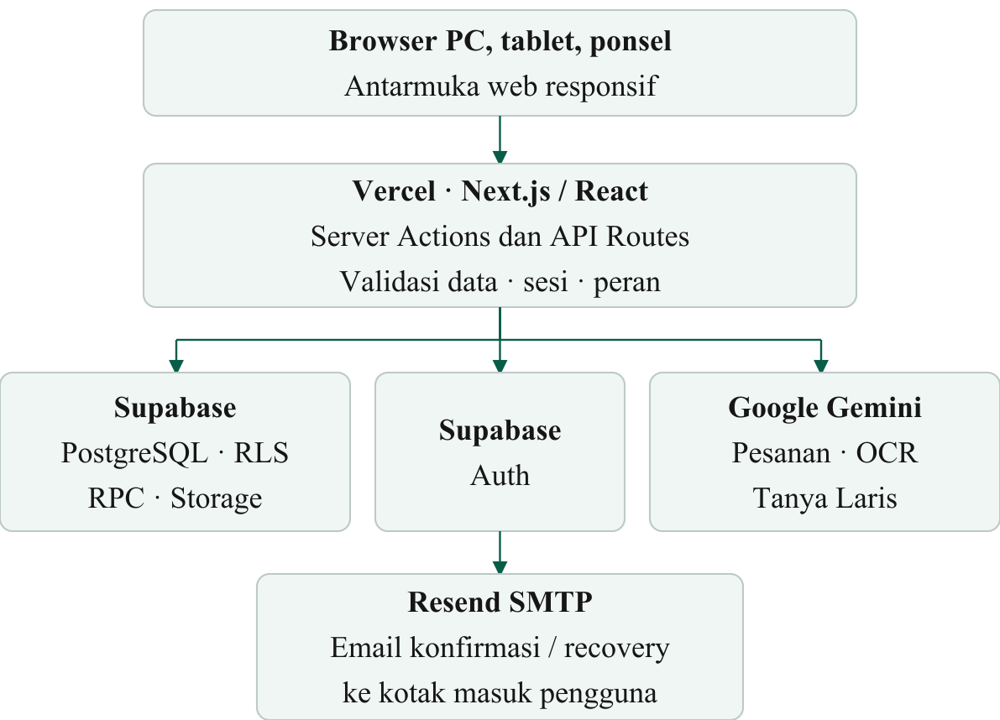

# Architecture

Laris is a Next.js application with a browser workspace, server actions/API routes, Supabase Auth/Postgres/Storage, and optional Gemini AI services.

## Main boundaries

- **Web UI:** authenticated workspace at `/` and explicit local demo at `/demo`.
- **Application layer:** server actions and `/api/ai/*` routes validate input, enforce session/workspace access, and call domain helpers.
- **Data layer:** Supabase Postgres stores tenant-scoped business data. Row Level Security and RPC functions protect mutations and inventory/accounting invariants.
- **AI layer:** Gemini handles optional voice/order parsing and OCR. AI results require human confirmation before ledger changes.
- **Deployment:** the production app runs on Vercel; Supabase provides authentication, database, and storage.
