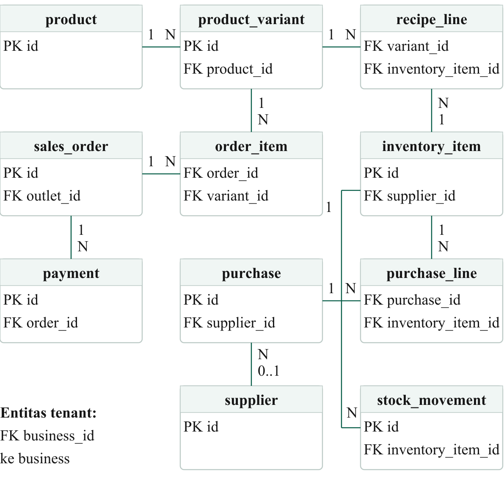

# Database ERD

The schema is designed around tenant isolation: operational records reference a `business_id`, while RLS policies and database functions enforce workspace membership and role permissions.

The migration history in [`supabase/migrations/`](../../supabase/migrations/) contains the complete schema, RLS policies, transactional RPCs, soft-delete behavior, configurable tax, and manual QRIS recording flow.
